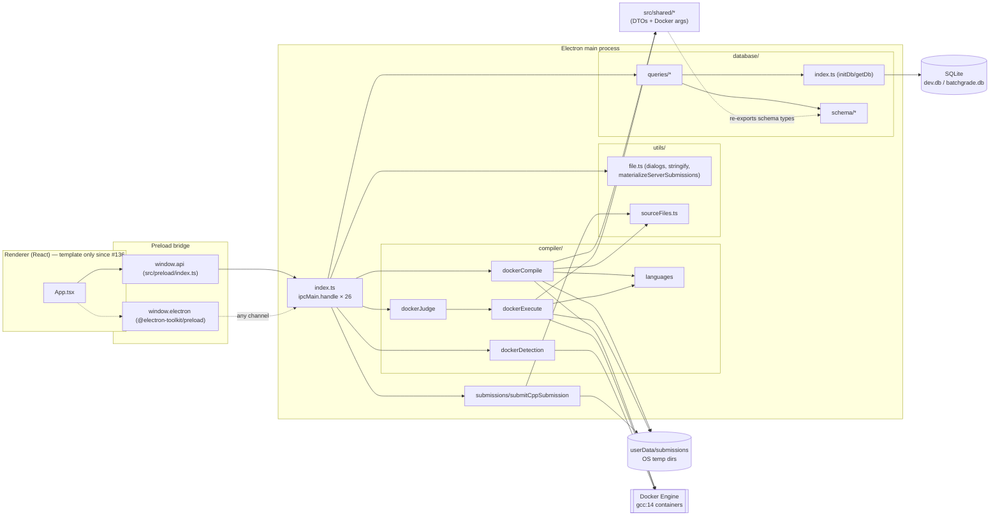
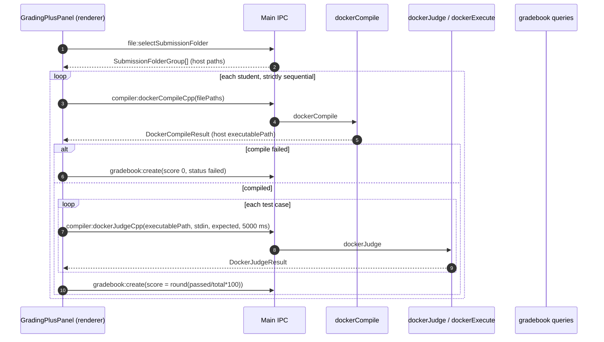

# 01 — Current Architecture Assessment

> Status: assessment of `main` at commit `7ffceda` (after PR #136 "Replaced renderer with clean template", PR #137 "Remove all local compiler files", and PR #139 "consolidate issue templates").
> Terminology follows the [glossary](README.md#glossary).

## 1. Summary

BatchGrade is an Electron desktop app. The main process exposes Docker-backed **primitives** (compile, execute, judge) and SQLite CRUD over IPC. The **grading workflow** itself (looping over students, compiling once, running each test case, scoring, saving to the gradebook) was implemented in the renderer in `GradingPlusPanel.tsx`. That component was deleted together with the rest of the UI in PR #136. As a result:

- Every building block of a C++ grading engine exists in `src/main/`, but **no backend component composes them into a workflow**.
- The previous workflow's rules (the score formula, the 5 s per-test timeout, sequential processing, gradebook writes) now exist only in git history (`d71b776^:src/renderer/src/components/grading/GradingPlusPanel.tsx`).
- The main process is tightly coupled to Electron (`app.getPath`, `dialog`, `ipcMain`), so none of it can run headless except the pure Docker helpers.

## 2. Implementation status

| Capability                                           | Status                               | Evidence                                                                                                                                                                                      |
| ---------------------------------------------------- | ------------------------------------ | --------------------------------------------------------------------------------------------------------------------------------------------------------------------------------------------- |
| Docker availability detection                        | **Implemented**                      | `src/main/compiler/dockerDetection.ts` → `detectDockerInstallation()` (runs `docker --version` and `docker ps`, 8 s timeouts)                                                                 |
| C++ compilation in Docker                            | **Implemented**                      | `src/main/compiler/dockerCompile.ts` → `dockerCompile()` (`gcc:14`, `g++`, 60 s timeout)                                                                                                      |
| Program execution in Docker                          | **Implemented**                      | `src/main/compiler/dockerExecute.ts` → `dockerExecute()` (one container per call, caller-supplied timeout)                                                                                    |
| Output judging (single test case)                    | **Implemented**                      | `src/main/compiler/dockerJudge.ts` → `dockerJudge()`, `cleanOutput()`                                                                                                                         |
| Submission intake to filesystem                      | **Implemented**                      | `src/main/submissions/submitCppSubmission.ts` → `submitCppSubmission()` (copies files and writes `submission-manifest.json`, `formatVersion: 1`)                                              |
| Submission intake to SQLite (single file, base64)    | **Implemented, unreachable from UI** | `src/main/database/queries/submissionServices.ts` → `createSubmission()`. The `submissions:create` IPC channel is registered in `src/main/index.ts` but not exposed in `src/preload/index.ts` |
| Assignment and test case CRUD                        | **Implemented**                      | `src/main/database/queries/assignment.ts` (`getAllAssignments`, `createAssignment`, `updateAssignment`, `deleteAssignment`, `getAssignmentTestCases`, `replaceAssignmentTestCases`)           |
| Gradebook persistence                                | **Implemented (lossy)**              | `src/main/database/queries/gradebook.ts` (`createGradebookRecord`, `getGradebookRecords`, `clearGradebookRecords`)                                                                            |
| Batch folder import                                  | **Implemented**                      | `src/main/utils/file.ts` → `selectSubmissionFolder()` (one sub-folder per student, top-level files only)                                                                                      |
| Server submission materialisation                    | **Implemented, no caller**           | `src/main/utils/file.ts` → `materializeServerSubmissions()`. The Supabase client that produced the bundles was in `src/renderer/src/lib/serverData.ts`, which #136 removed                    |
| Batch grading orchestration                          | **Removed** (#136)                   | Was in `GradingPlusPanel.gradeSingleStudent()` in the renderer                                                                                                                                |
| Scoring (`round(passed / total * 100)`)              | **Removed** (#136)                   | Was in `GradingPlusPanel.buildGradebookRecord()`                                                                                                                                              |
| Ad-hoc ("manual") test cases from input/output files | **Removed** (#136)                   | Was in `GradingPlusPanel.buildJudgeCases()`; files were paired by alphabetical order                                                                                                          |
| Local g++ compile/execute                            | **Removed** (#137)                   | `compileCppFiles.ts`, `executeCppFiles.ts`, `gccDetection.ts`, `judgeCppFiles.ts` deleted                                                                                                     |
| Python / Java support                                | **Placeholder only**                 | `src/main/compiler/languages.ts` (`pythonConfig`, `javaConfig`, `detectPythonMainFile`, `detectJavaMainClass`) — not in scope ([02](02-requirements.md#8-explicit-scope-exclusions))          |
| Cancellation, concurrency, progress events           | **Not implemented**                  | No `AbortController`, worker pool, or `webContents.send` anywhere in `src/main`                                                                                                               |
| Compile logs persistence                             | **Schema only**                      | `compile_logs` table in `src/main/database/schema/local.ts`; no writer                                                                                                                        |
| Login / roles                                        | **Schema only in main**              | `users` table and CRUD in `src/main/database/queries/users.ts`; the auth UI was removed in #136                                                                                               |

The design documents under `designs/MVP-1` … `designs/MVP-6` describe the intended MVP flows. For example, `designs/MVP-3/mvp-3.md` describes "passing test cases over the total number of unit tests", and `designs/MVP-5/mvp-5.md` describes instructor-defined input/output pairs. They are **descriptions of intent**. Where they differ from the code, this assessment treats the code as authoritative.

## 3. Current component diagram

## 4. How the existing workflows work

### 4.1 Compilation — `dockerCompile()`

1. Filters `sourceFiles` to `.cpp/.cc/.cxx` for C++ (hard-coded at `dockerCompile.ts:69-75`), ignoring `languages.ts` `cppConfig.extensions`.
2. Creates `mkdtemp(os.tmpdir()/batchgrade-docker-*)` and records it in a module-level `Set`. The directory is deleted only on `process.once('exit')` or on compile failure.
3. Computes `getCommonWorkingDirectory(sourceFiles)` and **bind-mounts that host directory read-only at `/src`**.
4. Runs `docker run --rm --init --name batchgrade-compile-<uuid> <DOCKER_SANDBOX_ARGS> [--user uid:gid on POSIX] -v <common>:/src:ro -v <tmp>:/out -w /src gcc:14 g++ <relative files> -o /out/batchgrade-program[.exe]`.
5. After 60 s it runs `docker kill <name>` and kills the CLI child process. stdout and stderr are concatenated into strings with no limit.
6. Returns `DockerCompileResult`, which includes a **host path** to the executable. The renderer kept that path and passed it back for judging.

### 4.2 Execution and judging — `dockerExecute()` / `dockerJudge()`

1. `dockerJudge()` calls `dockerExecute()` with `{ executablePath, stdin, timeoutMs }`.
2. `dockerExecute()` creates a new `mkdtemp(batchgrade-output-*)` **for every call**. That directory is only removed on process exit.
3. Mounts `dirname(executablePath)` read-only at `/app` and the new output directory **read-write at `/work`**, then pipes `stdin` and enforces `timeoutMs` with `docker kill`.
4. `success = !timedOut && exitCode === 0`. There is no distinction between a crash, running out of memory, or exiting with a non-zero status.
5. `dockerJudge()` compares outputs using `cleanOutput(s) = s.trim().replace(/\r\n/g,'\n').replace(/\r/g,'\n').replace(/\n+$/,'')`. **Leading** whitespace is also trimmed. `passed = success && outputsMatch`.

### 4.3 Batch grading (historical, removed in #136)

Any exception during this flow also produced a gradebook record with `score 0, status 'failed'`. The flow made no distinction between a failure caused by Docker or the system and a failure caused by the student's code.

### 4.4 Submission intake — `submitCppSubmission()`

It validates that `assignmentId`, `studentId`, and `sourceFiles` are non-empty. It then copies files to `app.getPath('userData')/submissions/<studentId>/<assignmentId>/<timestamp>-<uuid>/`, keeping their relative paths, and writes `submission-manifest.json`. The manifest is not recorded in SQLite and has no hashes. Nothing in the code reads it back.

## 5. Dependency relationships

| From                                          | Depends on                        | Problem                                                                                                                                                                                                                    |
| --------------------------------------------- | --------------------------------- | -------------------------------------------------------------------------------------------------------------------------------------------------------------------------------------------------------------------------- |
| `src/shared/types.ts`                         | `src/main/database/schema`        | **Inverted dependency.** Shared DTOs re-export Drizzle schema types and **values** (`VALID_ROLES`, …). `tsconfig.web.json` includes `src/shared/**`, so the renderer type graph reaches into the main process's DB schema. |
| `src/main/database/index.ts`                  | `electron.app`                    | Persistence cannot be opened outside Electron, except through the test mock in `tests/setup.ts`.                                                                                                                           |
| `src/main/submissions/submitCppSubmission.ts` | `electron.app`                    | Intake cannot run headless.                                                                                                                                                                                                |
| `src/main/utils/file.ts`                      | `electron.dialog`, `electron.app` | Pure helpers (`sanitizeFileSegment`, `buildSafeRelativePath`) sit in the same module as UI dialogs.                                                                                                                        |
| `src/main/compiler/*`                         | `src/shared/compiler.ts`          | Sandbox flags (`DOCKER_SANDBOX_ARGS`) live in a module shared with the renderer, even though only the main process uses them.                                                                                              |
| `src/main/index.ts`                           | everything                        | The single composition point also holds handler logic (the inline `dialog:openFile` handler).                                                                                                                              |

## 6. Architectural weaknesses and technical debt

### 6.1 Security

- **W1 — The renderer controls host paths that are mounted into containers.** `compiler:dockerCompileCpp` accepts any `string[]` from the renderer. `compiler:dockerJudgeCpp` accepts any `executablePath` and mounts `dirname(executablePath)` into the container, then executes the file. `file:stringify` reads any host file. A compromised or buggy renderer can mount or read arbitrary host directories.
- **W2 — Every IPC channel is reachable.** `@electron-toolkit/preload` exposes `window.electron.ipcRenderer`, so every `ipcMain.handle` channel can be invoked, including channels the typed `window.api` does not expose. The window is created with `sandbox: false` (`src/main/index.ts:51`).
- **W3 — Too much host filesystem is mounted for compilation.** `/src` is the _common ancestor_ of all selected files (`getCommonWorkingDirectory`). If files are selected from several folders, a broad host directory is mounted. A student's code can then `#include` neighbouring files, including other students' work, and the compiler diagnostics echo their contents back.
- **W4 — Output is unbounded.** stdout and stderr from compiler and program are accumulated in memory without a cap (`dockerCompile.ts:166-173`, `dockerExecute.ts:113-121`). A program that prints forever until the timeout can exhaust main-process memory.
- **W5 — Host disk writes are unbounded.** `/work` is a writable host bind mount with no size quota or `fsize` ulimit.
- **W6 — Sandbox hardening is incomplete.**
  - There is no `--read-only` root filesystem, no `tmpfs`, and no `--ulimit`.
  - Containers run as **root on Windows**, because `--user` is skipped when `process.platform === 'win32'`.
  - The same `--pids-limit 5` applies to compiling and to running.
  - The image tag `gcc:14` is mutable and not pinned to a digest.
- **W7 — Path traversal in intake.** `submitCppSubmission()` joins the renderer-supplied `studentId` and `assignmentId` directly into a filesystem path. A value containing `..` escapes the submissions directory.
- **W8 — Plaintext passwords.** The `users.password` column stores plaintext. This is out of scope for the grading engine but recorded for completeness.

### 6.2 Reliability and resource lifecycle

- **W9 — Temporary files leak.** Compile output directories survive until process exit, and every test execution creates a further directory. `process.once('exit')` does not run after a crash or `SIGKILL`, so these directories are leaked permanently.
- **W10 — The image pull counts against the compile timeout.** `docker run` pulls `gcc:14` (over 1 GB) on first use _within_ the 60 s compile timer, so the first compile on a new machine can time out.
- **W11 — No container lifecycle control.** `--rm` destroys the container before its state can be inspected, so an out-of-memory kill (exit 137) cannot be told apart from a crash or a timeout kill. If `docker kill` fails, the container may outlive the timer.
- **W12 — No cancellation, concurrency control, progress reporting, or recovery after a crash.**
- **W13 — Infrastructure failures are recorded as student failures** (historical flow §4.3). Losing the Docker daemon in the middle of a batch would have produced score-0 grades.

### 6.3 Coupling and cohesion

- **W14 — No orchestration layer.** The grading rules lived in a React component and are now gone. Nothing below the UI owns "grade a submission".
- **W15 — Electron is mixed with domain logic.** See §5.
- **W16 — Duplicated and inconsistent C++ file rules.** Each module has its own list:
  - `languages.ts`: `.cpp .cc .cxx .cp .h .hpp`
  - `dockerCompile.ts`: `.cpp .cc .cxx`
  - `sourceFiles.ts` (`getCppImplementationFiles`, unused): `.cpp .cc .cxx .cp`
  - `file.ts`: `cpp h cc cxx hpp cp`
  - the inline `dialog:openFile` handler: `cpp`
- **W17 — Unneeded multi-language placeholders.** Python and Java configs and helpers widen every type (`Language`) even though only C++ is supported.
- **W18 — Fragile result types.** `DockerCompileResult` carries both `success` and `compileSuccess`, and `compilerPath: 'docker'`. The Windows `exeExtension: '.exe'` is applied to a Linux ELF binary produced inside the container.
- **W19 — Dead or duplicate IPC.** `dialog:openFile` duplicates `file:select`. `submissions:create` and `submissions:getById` are not exposed in preload. The `ping` channel is a leftover.

### 6.4 Data model

- **W20 — Two assignment tables.** `assignments` (`schema/local.ts`: `title`, `config` blob) and `instructor_assignments` (`schema/assignment.ts`) both model an assignment. Test cases reference `instructor_assignments`. Submissions and grades reference `assignments`.
- **W21 — Two submission models.** The `submissions` table stores a single base64 file and has no student column. `submitCppSubmission` writes a multi-file manifest to disk. Neither knows about the other.
- **W22 — The gradebook writes synthetic rows and loses data.**
  - `createGradebookRecord()` silently inserts an `assignments` row for unknown IDs.
  - It also inserts a fake `submissions` row with `fileName = studentName` and `fileContent = ''`.
  - `getGradebookRecords()` returns `passedCount: 0`, `totalCount: 0` and `studentId = studentName`.
  - `clearGradebookRecords()` deletes `grades` only, which leaves orphaned `submissions` rows behind.
- **W23 — Wrong foreign key.** `compile_logs.submission_id` references `assignments.uuid` instead of `submissions.uuid`.
- **W24 — Inconsistent migration metadata.** `migrations/meta/` contains snapshots for `0000` and `0001` but **not `0002`**, even though `_journal.json` lists `0002_assignment_test_cases`. The next `drizzle-kit generate` will diff against a stale snapshot. In addition, the journal's `when` value for `0001` is earlier than for `0000`.
- **W25 — No grading history.** There is no record of which test cases, limits, or compiler image produced a grade. `replaceAssignmentTestCases()` deletes and re-inserts rows (new UUIDs), so references to earlier test cases are not stable.

## 7. Components worth preserving

| Component                                                                                                                    | Why it is worth keeping                                                      | Target home ([03](03-target-architecture.md#9-proposed-directory-structure)) |
| ---------------------------------------------------------------------------------------------------------------------------- | ---------------------------------------------------------------------------- | ---------------------------------------------------------------------------- |
| Docker argument pattern + named-container `docker kill` on timeout (`dockerCompile`, `dockerExecute`)                        | Proven to work on all three CI operating systems; tests cover the edge cases | `infrastructure/docker/dockerCli.ts`                                         |
| `DOCKER_SANDBOX_ARGS` values (network none, cap-drop ALL, no-new-privileges, 256 MB memory with no extra swap, 1 CPU)        | Sensible baseline; becomes the default `ResourceLimits`                      | `infrastructure/docker/sandboxPolicy.ts`                                     |
| `detectDockerInstallation()`                                                                                                 | Self-contained and already headless                                          | `infrastructure/docker/dockerDetection.ts`                                   |
| `cleanOutput()` semantics                                                                                                    | Defines today's pass/fail behaviour                                          | `domain/judge.ts` as the `normalized` comparison mode                        |
| `sanitizeFileSegment()`, `buildSafeRelativePath()` (`utils/file.ts`), `getSubmissionRelativePath()` (`utils/sourceFiles.ts`) | Already reject `..` and unsafe characters                                    | `infrastructure/storage/safePaths.ts`                                        |
| `assignment_test_cases` schema with `(assignment_uuid, case_order)` unique index                                             | Correct shape for ordered test suites                                        | Kept and extended ([05](05-data-model.md))                                   |
| Manifest `formatVersion: 1`                                                                                                  | A versioned on-disk format is already in place                               | Superseded by manifest v2 (a superset)                                       |
| Test style: mocked `child_process.spawn` + in-memory SQLite (`tests/setup.ts`)                                               | Fast tests that need no Docker                                               | Reused for adapter and repository tests                                      |

## 8. Migration risks

| Risk                                                                                                            | Impact                                                                              | Mitigation (see [07](07-migration-plan.md))                                                   |
| --------------------------------------------------------------------------------------------------------------- | ----------------------------------------------------------------------------------- | --------------------------------------------------------------------------------------------- |
| The renderer is a template, so "existing behaviour" is mostly the IPC contract and the grading rules in history | Rules could be lost silently                                                        | Capture the rules as domain unit tests first (P1)                                             |
| Tests assert exact `docker` argument arrays (for example `tests/compiler/dockerCompile.test.ts`)                | Hardening flags break tests                                                         | Update tests deliberately in P3a/P3b and keep tests that assert result shapes                 |
| 90 % statement coverage gate on `src/main/**` (`vitest.config.ts`)                                              | New modules without tests fail CI                                                   | Each phase ships with unit tests that use fakes                                               |
| Missing `0002` snapshot (W24)                                                                                   | Generated migrations may drop or recreate tables                                    | Repair the metadata before any schema change (P5a)                                            |
| Containers per test on macOS/Windows (Docker Desktop VM) are slow                                               | Batch throughput                                                                    | Measure in P4; bounded concurrency in P6 ([ADR-0003](adr/0003-docker-sandbox-strategy.md))    |
| `better-sqlite3` is rebuilt for Electron's ABI (`postinstall`)                                                  | Headless persistence under plain Node needs a Node-ABI build                        | Milestone 1 uses an in-memory repository; `test:ci` already runs `npm rebuild better-sqlite3` |
| No single-instance lock (`app.requestSingleInstanceLock` unused)                                                | A second app instance's recovery sweep could remove the first instance's containers | Add the lock when the sweep is introduced (P6)                                                |
