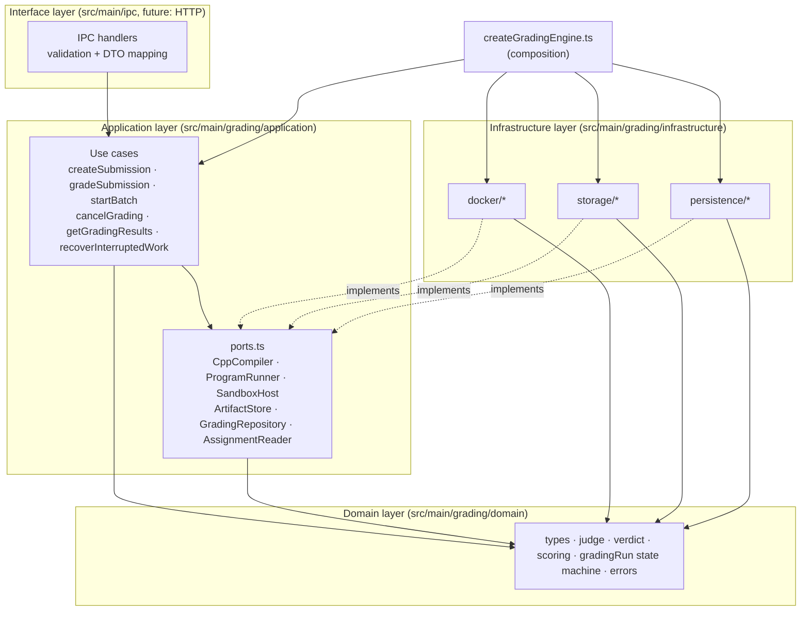
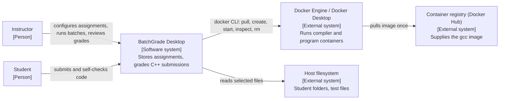
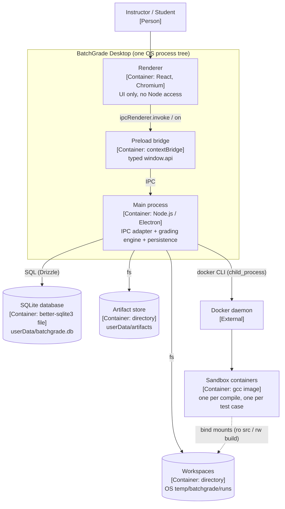
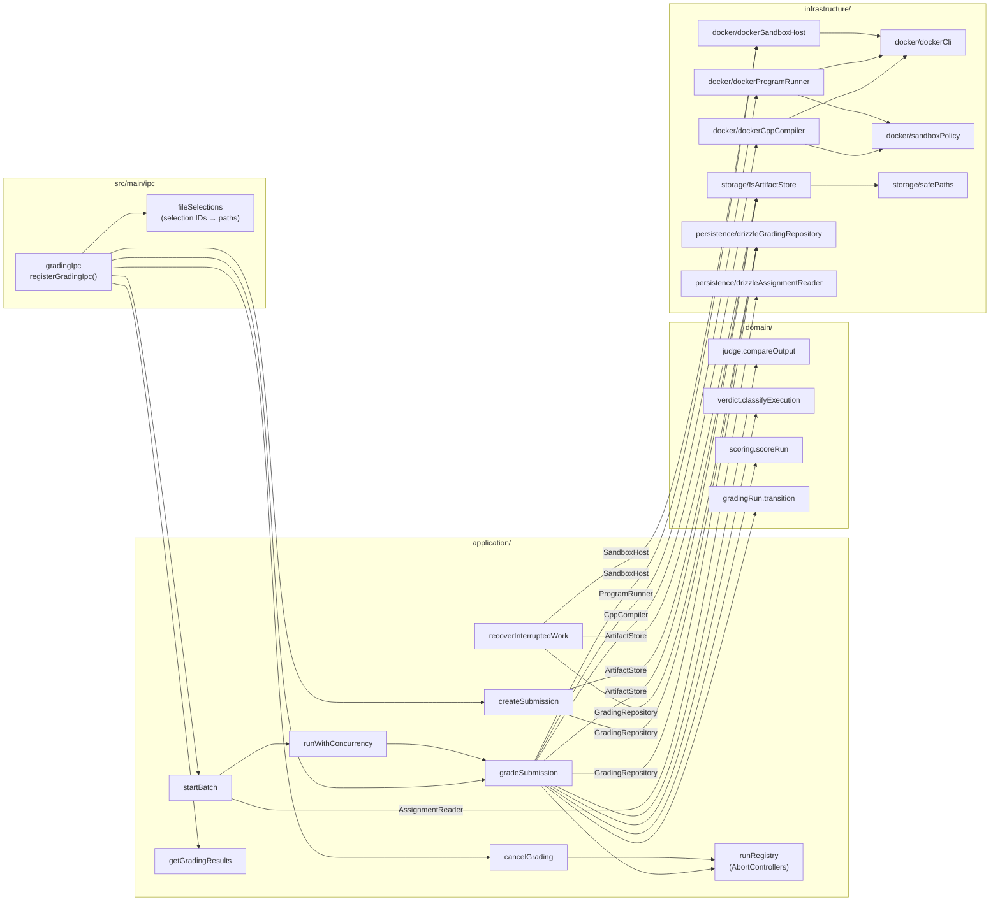
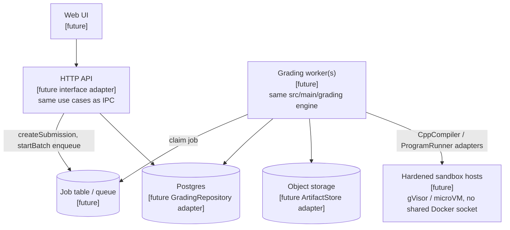
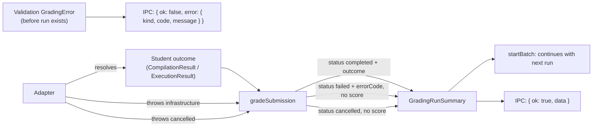

# 03 — Target Architecture

> Terminology follows the [glossary](README.md#glossary). Requirement IDs refer to [02](02-requirements.md). Decisions are recorded in [ADRs](adr/).

## 1. Architectural style and justification

**Style:** a **modular monolith** organised in **layers**, with **ports and adapters** used only at the engine's real external boundaries (Docker, filesystem, database, assignment data). See [ADR-0001](adr/0001-modular-monolith.md) and [ADR-0002](adr/0002-layers-and-dependency-direction.md).

Why this style fits BatchGrade:

| Force                                                                          | Consequence                                                                                                                                 |
| ------------------------------------------------------------------------------ | ------------------------------------------------------------------------------------------------------------------------------------------- |
| One desktop process, one user, one SQLite file (NFR-3)                         | Network boundaries between components would add failure modes without any benefit, so the system stays a monolith.                          |
| Grading rules were lost when the UI was replaced (W14)                         | Rules move to a **domain** layer that has no I/O, where unit tests can pin them down (TEST-1).                                              |
| The engine must run without Electron (NFR-4) and later inside a server (NFR-6) | Electron becomes an **interface adapter** on the outside. The engine depends only on its ports.                                             |
| Docker, the filesystem and SQLite have no in-process substitute in tests       | These are the **ports**. Each has one real adapter and one test fake.                                                                       |
| Small team, student project cadence                                            | **No** DI container, no generic repository, no class hierarchies, no event bus. Dependencies are wired by hand in one composition function. |

What we deliberately **do not** adopt from textbook Clean Architecture is listed in [§14](#14-rejected-abstractions).

## 2. Layers and dependency rules



**Permitted dependencies** (an arrow means "may import"):

| Layer                                  | May import                                                                                   | Must not import                                                                                          |
| -------------------------------------- | -------------------------------------------------------------------------------------------- | -------------------------------------------------------------------------------------------------------- |
| Domain                                 | nothing outside `domain/` (Node built-ins limited to `crypto` for hashing)                   | `fs`, `child_process`, `drizzle-orm`, `electron`, anything in application, infrastructure or interface   |
| Application                            | `domain/`                                                                                    | `infrastructure/`, `electron`, `drizzle-orm`, `child_process`, `fs`                                      |
| Infrastructure                         | `domain/`, `application/ports.ts`, Node built-ins, `drizzle-orm`, `src/main/database/schema` | `electron`, other adapters' internals, use cases                                                         |
| Composition (`createGradingEngine.ts`) | everything inside `src/main/grading/`                                                        | `electron`                                                                                               |
| Interface (`src/main/ipc/`)            | `createGradingEngine.ts` exports, `domain/` types, `src/shared/` DTOs, `electron`            | infrastructure internals                                                                                 |
| `src/shared/`                          | nothing from `src/main/`                                                                     | `src/main/**` (fixes the inverted dependency in [01 §5](01-current-state.md#5-dependency-relationships)) |

These rules are enforced with ESLint `no-restricted-imports` overrides per folder (TEST-6), added in phase P1 ([07](07-migration-plan.md)).

## 3. System context (C4 level 1)



## 4. Containers (C4 level 2) — desktop deployment



## 5. Components of the grading module (C4 level 3)



### Component responsibilities

| Component                                   | Responsibility (single reason to change)                                                                                                                |
| ------------------------------------------- | ------------------------------------------------------------------------------------------------------------------------------------------------------- |
| `domain/judge`                              | Normalise and compare output (`compareOutput(expected, actual, mode)`).                                                                                 |
| `domain/verdict`                            | Map an `ExecutionResult` plus a comparison result to a `Verdict` ([04 §5](04-grading-workflow.md#5-verdict-classification)).                            |
| `domain/scoring`                            | Compute `score`, `passedCount`, and `totalCount` from `TestResult[]` and the `GradingPolicy`.                                                           |
| `domain/gradingRun`                         | Allowed `RunStatus` transitions; rejects illegal transitions.                                                                                           |
| `application/createSubmission`              | Validate incoming files and store an immutable `Submission` (workflow steps 1–2).                                                                       |
| `application/gradeSubmission`               | Orchestrate one `GradingRun` (steps 3–12). The **only** component that sequences compile → run → judge → score → persist.                               |
| `application/startBatch`                    | Freeze the test suite, create a `GradingBatch`, schedule runs with bounded concurrency, and aggregate progress.                                         |
| `application/cancelGrading`                 | Abort a run or a batch through the `runRegistry`.                                                                                                       |
| `application/getGradingResults`             | Read-side queries for runs, batches, and gradebook views.                                                                                               |
| `application/recoverInterruptedWork`        | At startup, mark orphaned runs as failed and sweep containers and workspaces.                                                                           |
| `infrastructure/docker/dockerCli`           | Spawn `docker` with argument arrays, label containers, cap output, honour `AbortSignal`, and guarantee `rm -f`. Knows nothing about compilers or tests. |
| `infrastructure/docker/sandboxPolicy`       | Translate `ResourceLimits` into `docker create` flags (the only place sandbox flags exist).                                                             |
| `infrastructure/docker/dockerCppCompiler`   | `CppCompiler` adapter: the `g++` command line inside the container.                                                                                     |
| `infrastructure/docker/dockerProgramRunner` | `ProgramRunner` adapter: run one binary with one stdin; report the exit code, `timedOut`, and `oomKilled`.                                              |
| `infrastructure/docker/dockerSandboxHost`   | `SandboxHost` adapter: Docker availability check, image pull and pin, orphan removal.                                                                   |
| `infrastructure/storage/fsArtifactStore`    | `ArtifactStore` adapter: snapshots, workspaces, run artifacts, test-suite files.                                                                        |
| `infrastructure/storage/safePaths`          | Sanitising path segments and checking that paths stay inside a root (preserved from `utils/file.ts`).                                                   |
| `infrastructure/persistence/*`              | `GradingRepository` / `AssignmentReader` with Drizzle.                                                                                                  |
| `ipc/gradingIpc`                            | Validate IPC payloads, call use cases, convert errors to result envelopes, forward progress to `webContents`.                                           |
| `ipc/fileSelections`                        | Issue opaque selection IDs for dialog results so the renderer never sends host paths (SEC-5).                                                           |

## 6. Application use cases

| Use case                 | Input                                                                                                   | Output                                                 | Notes                                                                                                                                                                                     |
| ------------------------ | ------------------------------------------------------------------------------------------------------- | ------------------------------------------------------ | ----------------------------------------------------------------------------------------------------------------------------------------------------------------------------------------- |
| `createSubmission`       | `{ assignmentId \| null, studentRef, studentDisplayName, files: { hostPath, relativePath }[], source }` | `Submission`                                           | Throws `GradingError(validation)` ([§11](#11-error-handling-and-failure-propagation)). Copies and hashes the files. Never mounts or executes anything.                                    |
| `gradeSubmission`        | `{ submissionId, suite: TestSuiteRef, policy?, batchId? }`, `{ signal?, onProgress? }`                  | `GradingRunSummary`                                    | Never throws for student-caused outcomes or infrastructure failures. Those become the run's `status`/`outcome`. Throws only on validation failures that happen before the run is created. |
| `startBatch`             | `{ submissionIds, suite: TestSuiteRef, concurrency? }`, `{ onProgress? }`                               | `{ batchId, done: Promise<BatchSummary> }`             | Returns as soon as the batch is persisted, so IPC can reply immediately. A headless caller awaits `done`.                                                                                 |
| `cancelGrading`          | `{ runId } \| { batchId }`                                                                              | `{ status }`                                           | Idempotent. A target that is already terminal is a no-op.                                                                                                                                 |
| `getGradingResults`      | `{ runId } \| { batchId } \| { assignmentId }`                                                          | DTOs                                                   | Read-only.                                                                                                                                                                                |
| `recoverInterruptedWork` | —                                                                                                       | `{ runsFailed, containersRemoved, workspacesRemoved }` | Called once at startup, after the database is open.                                                                                                                                       |

`TestSuiteRef` is either `{ kind: 'assignment', assignmentId }` or `{ kind: 'ad_hoc', cases: TestCaseInput[] }`, which covers FR-11.

The redesign brief used different names for some of these use cases. The mapping is: _GradeSubmission_ → `gradeSubmission`, _GradeBatch_ → `startBatch` (named for what it returns, a handle to a running batch), _CancelGradingRun_ → `cancelGrading` (it accepts a run or a batch), and _GetGradingResults_ → `getGradingResults`. `createSubmission` and `recoverInterruptedWork` are additional use cases needed for workflow steps 1–2 and for REL-3.

## 7. Interfaces and contracts

### 7.1 Core domain types

```ts
type RunStatus =
  | 'queued'
  | 'preparing'
  | 'compiling'
  | 'testing'
  | 'completed'
  | 'failed'
  | 'cancelled'
type RunOutcome = 'graded' | 'compile_error' // only set when status === 'completed'
type Verdict =
  | 'passed'
  | 'wrong_answer'
  | 'runtime_error'
  | 'time_limit_exceeded'
  | 'memory_limit_exceeded'
  | 'output_limit_exceeded'
  | 'skipped'

interface ResourceLimits {
  wallTimeMs: number // compile default 60_000, test default 5_000 (current behaviour)
  memoryMb: number // default 256 (current)
  cpus: number // default 1 (current)
  pids: number // compile 16 (proposed), run 5 (current)
  outputCaptureBytes: number // per stream, default 1 MiB (proposed, PERF-5)
  fileSizeBytes: number // RLIMIT_FSIZE, default 16 MiB (proposed)
  tmpfsMb: number // size of /tmp and /work, default 64 (compile) / 16 (run) (proposed)
}

interface GradingPolicy {
  compareMode: 'normalized' // == today's cleanOutput(); more modes are open decision D11
  compilerFlags: string[] // default [] == today's behaviour (open decision D2)
  compileLimits: ResourceLimits
  testLimits: ResourceLimits // TestCase.timeoutMs overrides wallTimeMs
  scoring: 'percent_passed' // round(passed / total * 100); 'weighted_points' is open decision D9
}

interface CapturedText {
  text: string
  truncated: boolean
  totalBytes: number
}

interface CompilationResult {
  status: 'succeeded' | 'failed' | 'timed_out'
  exitCode: number | null
  stdout: CapturedText
  stderr: CapturedText
  durationMs: number
}

interface ExecutionResult {
  exitCode: number | null
  timedOut: boolean
  oomKilled: boolean
  outputLimitExceeded: boolean
  stdout: CapturedText
  stderr: CapturedText
  durationMs: number
}
```

### 7.2 Ports (`application/ports.ts`)

All ports are `async`, so a future server adapter (for example a Postgres repository) fits the same contract. Every long-running method takes an `AbortSignal`.

```ts
interface Workspace {
  readonly runId: string
  readonly sourceDir: string // copy of the submission snapshot (mounted read-only)
  readonly buildDir: string // compiler output (mounted read-write for compile, read-only for run)
  dispose(): Promise<void> // idempotent; removes the whole workspace
}

interface BinaryRef {
  readonly workspace: Workspace
  readonly fileName: string
} // never leaves the engine

interface CppCompiler {
  /** Resolves for every student-caused outcome; rejects only with GradingError(infrastructure|cancelled). */
  compile(
    req: {
      runId: string
      workspace: Workspace
      sourceFiles: string[]
      flags: string[]
      limits: ResourceLimits
    },
    signal: AbortSignal
  ): Promise<{ result: CompilationResult; binary: BinaryRef | null }>
}

interface ProgramRunner {
  /** Resolves for every program behaviour (crash, timeout, OOM, huge output); rejects only for sandbox failure or cancellation. */
  run(
    req: {
      runId: string
      testOrder: number
      binary: BinaryRef
      stdin: string
      limits: ResourceLimits
    },
    signal: AbortSignal
  ): Promise<ExecutionResult>
}

interface SandboxHost {
  checkAvailability(): Promise<{
    status: 'ready' | 'missing' | 'not-running'
    version: string | null
  }>
  /** Ensures the pinned image is present locally; may pull. Never runs under a grading timer. */
  prepareImage(signal: AbortSignal): Promise<{ image: string; digest: string | null }>
  /** Removes every container labelled batchgrade.managed=true. */
  removeOrphans(): Promise<number>
}

interface ArtifactStore {
  storeSubmission(
    submissionId: string,
    files: { hostPath: string; relativePath: string }[]
  ): Promise<StoredSubmissionManifest>
  createWorkspace(runId: string, submissionId: string): Promise<Workspace>
  storeTestSuite(suite: TestSuite): Promise<{ sha256: string; artifactPath: string }>
  writeRunArtifact(runId: string, name: string, content: string): Promise<string> // returns path relative to artifact root
  sweepWorkspaces(): Promise<number>
}

interface GradingRepository {
  insertSubmission(s: Submission): Promise<void>
  getSubmission(id: string): Promise<Submission | null>
  insertBatch(b: GradingBatch): Promise<void>
  updateBatch(
    id: string,
    patch: Partial<Pick<GradingBatch, 'status' | 'finishedAt'>>
  ): Promise<void>
  insertRun(r: GradingRun): Promise<void>
  updateRun(id: string, patch: GradingRunPatch): Promise<void> // status / outcome / score / error
  saveCompilation(
    runId: string,
    result: CompilationResult,
    logArtifactPath: string | null
  ): Promise<void>
  saveTestResult(runId: string, result: TestResult): Promise<void>
  failNonTerminalRuns(errorCode: 'INTERRUPTED'): Promise<number> // recovery
  findRuns(query: RunQuery): Promise<GradingRunView[]>
}

interface AssignmentReader {
  loadForGrading(
    assignmentId: string
  ): Promise<{ cases: TestCaseInput[]; policy: Partial<GradingPolicy> } | null>
}
```

Progress is **not** a port. It is an optional callback, `onProgress(event: GradingProgressEvent)`, passed to a use case. Events: `run_status_changed`, `test_completed`, `batch_progress`. Delivery is best-effort: a throwing listener is caught and logged, and it never affects grading.

### 7.3 Contract rules that callers may rely on

1. **Student-caused outcomes are values, not exceptions.** Compile errors, crashes, timeouts, OOM kills and oversized output all resolve normally.
2. **Infrastructure failures are exceptions** carrying `GradingError{ kind: 'infrastructure', code, retryable }`.
3. **Cancellation is an exception** carrying `GradingError{ kind: 'cancelled' }`, raised once the adapter has stopped its container.
4. Adapters own the cleanup of their own resources: a container created by `compile`/`run` is removed before the promise settles. The workspace belongs to `gradeSubmission`, which disposes of it in a `finally` block.
5. No port returns or accepts a host path that originated in the renderer.

## 8. Infrastructure adapters

| Adapter                     | Implements          | Built from (existing code)                                    | Key behaviour                                                                                                                                                                                                        |
| --------------------------- | ------------------- | ------------------------------------------------------------- | -------------------------------------------------------------------------------------------------------------------------------------------------------------------------------------------------------------------- |
| `dockerCli`                 | (internal helper)   | spawn/kill logic in `dockerCompile.ts` and `dockerExecute.ts` | `create` → `start -a [-i]` → `inspect` → `rm -f` in `finally`. Labels `batchgrade.managed=true`, `batchgrade.run=<runId>`, `batchgrade.role=compile\|test`. Kills on timeout or abort. Captures streams up to a cap. |
| `sandboxPolicy`             | (internal helper)   | `DOCKER_SANDBOX_ARGS` in `src/shared/compiler.ts`             | Builds the full flag list ([06 §4](06-security.md#4-security-controls)). Picks the per-platform `--user`.                                                                                                            |
| `dockerCppCompiler`         | `CppCompiler`       | `dockerCompile()`                                             | Mounts `sourceDir:/src:ro` and `buildDir:/build:rw`, runs `g++ <flags> <files> -o /build/program`.                                                                                                                   |
| `dockerProgramRunner`       | `ProgramRunner`     | `dockerExecute()`                                             | Mounts `buildDir:/app:ro`, `/work` as tmpfs, pipes stdin.                                                                                                                                                            |
| `dockerSandboxHost`         | `SandboxHost`       | `detectDockerInstallation()`                                  | `docker image inspect` → `docker pull` if missing. `docker ps -aq --filter label=batchgrade.managed=true` → `rm -f`.                                                                                                 |
| `fsArtifactStore`           | `ArtifactStore`     | `submitCppSubmission()` file copy, `safePaths`                | Layout in [05 §6](05-data-model.md#6-sqlite-vs-filesystem-artifact-storage). Rejects symlinks (`lstat`) and paths outside the root.                                                                                  |
| `drizzleGradingRepository`  | `GradingRepository` | `src/main/database/queries/*` style                           | Receives a Drizzle instance in its constructor function. Does **not** call `getDb()`.                                                                                                                                |
| `drizzleAssignmentReader`   | `AssignmentReader`  | `getAssignmentTestCases()`                                    | Read-only. Maps rows to `TestCaseInput`.                                                                                                                                                                             |
| `inMemoryGradingRepository` | `GradingRepository` | —                                                             | Test fake. Also used by the headless milestone (P4).                                                                                                                                                                 |

## 9. Proposed directory structure

```text
src/
  main/
    index.ts                         # Electron bootstrap only: window, initDb, createGradingEngine, register IPC
    ipc/
      gradingIpc.ts                  # new grading:* channels
      fileSelections.ts              # selection-ID registry for dialog results
      legacyIpc.ts                   # existing channels (compiler:*, submissions:submitCpp, gradebook:*) until P8
    grading/                         # ── engine: MUST NOT import 'electron' ──
      createGradingEngine.ts         # composition: ports in, use cases out
      domain/
        types.ts  judge.ts  verdict.ts  scoring.ts  gradingRun.ts  errors.ts  testSuite.ts
      application/
        ports.ts  createSubmission.ts  gradeSubmission.ts  startBatch.ts
        cancelGrading.ts  getGradingResults.ts  recoverInterruptedWork.ts
        runRegistry.ts  runWithConcurrency.ts
      infrastructure/
        docker/    dockerCli.ts  sandboxPolicy.ts  dockerCppCompiler.ts  dockerProgramRunner.ts
                   dockerSandboxHost.ts  dockerDetection.ts
        storage/   fsArtifactStore.ts  safePaths.ts
        persistence/ drizzleGradingRepository.ts  drizzleAssignmentReader.ts  inMemoryGradingRepository.ts
    database/                        # stays: schema, migrations, CRUD queries for assignments/users
      openDatabase.ts                # new: openDatabase(path, migrationsFolder) without electron (P5b)
    compiler/                        # shrinks to compatibility wrappers, then removed in P8
    submissions/                     # submitCppSubmission delegates to createSubmission (P2), then removed in P8
  shared/                            # IPC DTOs only; no imports from src/main
tests/
  grading/domain/  grading/application/  grading/infrastructure/  integration/  (mirrors src)
```

Why `src/main/grading/` and not a top-level `src/core/`: the existing `tsconfig.node.json` `include`, the electron-vite `main` bundle, and the coverage `include` (`./src/main/**/*.ts`) all cover it without configuration changes. Independence from Electron is enforced by a lint rule rather than by folder placement. Trade-offs are in [ADR-0006](adr/0006-engine-independent-of-electron.md).

## 10. Deployment views: desktop now, SaaS later

**Desktop (the only deployment that will be built):** see [§4](#4-containers-c4-level-2--desktop-deployment). The engine runs in-process in the Electron main process. Batches are scheduled in memory. State lives in SQLite and on the local filesystem.

**Possible future SaaS (not designed for implementation, shown only to check the boundaries):**



What has to be true now so that this stays possible, and nothing more:

| Seam                                                        | Desktop now                           | SaaS later                                                      |
| ----------------------------------------------------------- | ------------------------------------- | --------------------------------------------------------------- |
| Engine has no `electron` import                             | lint rule                             | engine runs in a Node worker unchanged                          |
| Ports are async and accept `AbortSignal`                    | wrap synchronous better-sqlite3 calls | Postgres and object storage drivers                             |
| `startBatch` returns `{ batchId, done }`                    | in-memory pool                        | `startBatch` becomes "enqueue". Workers call `gradeSubmission`. |
| Paths in the database are **relative to the artifact root** | `userData/artifacts`                  | bucket prefix                                                   |
| IDs are UUIDs generated by the engine                       | —                                     | globally unique across tenants                                  |

What is **not** done now: tenancy columns, authentication, a job table, HTTP, and remote sandbox hosts. The multi-tenant security differences are in [06 §7](06-security.md#7-desktop-vs-public-multi-tenant-deployment).

## 11. Error handling and failure propagation

There is one error class rather than a hierarchy:

```ts
class GradingError extends Error {
  constructor(
    readonly kind: 'validation' | 'infrastructure' | 'cancelled',
    readonly code: GradingErrorCode,
    message: string,
    readonly retryable = false,
    readonly cause?: unknown
  ) {
    super(message)
  }
}
```

| Code                                                                                                              | Kind           | Raised by                                                        | Retryable               |
| ----------------------------------------------------------------------------------------------------------------- | -------------- | ---------------------------------------------------------------- | ----------------------- |
| `NO_SOURCE_FILES`, `UNSUPPORTED_FILE_TYPE`, `FILE_TOO_LARGE`, `TOO_MANY_FILES`, `SYMLINK_REJECTED`, `UNSAFE_PATH` | validation     | `createSubmission` / `fsArtifactStore`                           | no                      |
| `SUBMISSION_NOT_FOUND`, `ASSIGNMENT_NOT_FOUND`, `NO_TEST_CASES`                                                   | validation     | `gradeSubmission`, `startBatch`                                  | no                      |
| `DOCKER_UNAVAILABLE`                                                                                              | infrastructure | `dockerCli` (spawn `ENOENT`, daemon not reachable)               | no (user action needed) |
| `IMAGE_UNAVAILABLE`                                                                                               | infrastructure | `dockerSandboxHost.prepareImage`                                 | no                      |
| `CONTAINER_START_FAILED`                                                                                          | infrastructure | `dockerCli` (`create`/`start` non-zero before the program runs)  | **yes, once**           |
| `SANDBOX_STATE_UNKNOWN`                                                                                           | infrastructure | `dockerCli` (`inspect` failed after the program ran)             | no                      |
| `WORKSPACE_IO`                                                                                                    | infrastructure | `fsArtifactStore`                                                | no                      |
| `PERSISTENCE_FAILED`                                                                                              | infrastructure | repositories                                                     | no                      |
| `INTERRUPTED`                                                                                                     | infrastructure | `recoverInterruptedWork` (written to the database, never thrown) | —                       |
| `CANCELLED`                                                                                                       | cancelled      | any adapter when the `AbortSignal` fires                         | no                      |

How each kind propagates:



- `gradeSubmission` catches every `GradingError` raised after the run has been created and records it on the run (`status`, `errorCode`, `errorMessage`). Unexpected errors (bugs) are wrapped as `infrastructure/INTERNAL` and recorded the same way. **No score is written for `failed` or `cancelled` runs** (REL-1).
- IPC handlers return a **result envelope** (`{ ok: true, data } | { ok: false, error }`) instead of rejecting, because `ipcMain.handle` rejections only serialise `message` to the renderer. Existing channels keep their current shapes until P8.

## 12. Dependency injection approach

Wiring is manual, in exactly one function per runtime:

```ts
// src/main/grading/createGradingEngine.ts — no electron import
export function createGradingEngine(deps: {
  compiler: CppCompiler
  runner: ProgramRunner
  sandbox: SandboxHost
  artifacts: ArtifactStore
  repository: GradingRepository
  assignments: AssignmentReader
  defaults?: Partial<GradingPolicy>
  maxConcurrency?: number
  now?: () => Date // test seam only
}) {
  const registry = createRunRegistry()
  return {
    createSubmission: (input) => createSubmission(deps, input),
    gradeSubmission: (input, opts) => gradeSubmission({ ...deps, registry }, input, opts),
    startBatch: (input, opts) => startBatch({ ...deps, registry }, input, opts),
    cancelGrading: (target) => cancelGrading(registry, deps.repository, target),
    getGradingResults: (query) => getGradingResults(deps.repository, query),
    recoverInterruptedWork: () => recoverInterruptedWork(deps)
  }
}
```

- **Desktop:** `src/main/index.ts` builds the Docker, filesystem, and Drizzle adapters using `app.getPath('userData')`, calls `createGradingEngine`, then `registerGradingIpc(engine, …)`.
- **Headless / tests:** a test builds the real Docker adapters plus `inMemoryGradingRepository` (or fakes for everything) and calls the same function.
- Use cases are plain functions taking a `deps` object. There are no classes, decorators, or containers. Module-level singletons (`getDb()`, the `Set` registries in `dockerCompile.ts`/`dockerExecute.ts`) are not used inside the engine.

## 13. Interface layer: IPC contract

New channels (added in P7). Each returns a result envelope:

| Channel                                    | Payload                                                                                              | Returns                                                                   |
| ------------------------------------------ | ---------------------------------------------------------------------------------------------------- | ------------------------------------------------------------------------- |
| `grading:createSubmission`                 | `{ assignmentId?, studentRef, studentDisplayName, selectionId }`                                     | `Submission`                                                              |
| `grading:gradeSubmission`                  | `{ submissionId, suite: TestSuiteRefDto }`                                                           | `GradingRunSummary`                                                       |
| `grading:startBatch`                       | `{ suite: TestSuiteRefDto, items: { selectionId, studentRef, studentDisplayName }[], concurrency? }` | `{ batchId }`                                                             |
| `grading:cancel`                           | `{ runId } \| { batchId }`                                                                           | `{ status }`                                                              |
| `grading:getResults`                       | `{ runId } \| { batchId } \| { assignmentId }`                                                       | views                                                                     |
| `grading:progress` (main → renderer event) | `GradingProgressEvent`                                                                               | —                                                                         |
| `file:select*` (existing, changed in P7)   | —                                                                                                    | `{ selectionId, displayNames[] }` instead of host paths for the new flows |

Validation uses small hand-written type guards in `ipc/gradingIpc.ts`. No schema library is added (NFR-5). The existing channels listed in [01 §2](01-current-state.md#2-implementation-status) keep their behaviour until P8.

## 14. Rejected abstractions

| Not doing                                   | Why                                                                                                                               |
| ------------------------------------------- | --------------------------------------------------------------------------------------------------------------------------------- |
| A `Language` / strategy hierarchy           | C++ only (EX-1). `CppCompiler` is a concrete port. Adding a language later means adding ports and adapters, not generalising now. |
| A DI container or decorators                | Six ports and one composition function. A container would hide the wiring.                                                        |
| A generic `Repository<T>` / unit-of-work    | Repositories expose the queries the use cases need and nothing more.                                                              |
| An event bus / domain events infrastructure | One optional `onProgress` callback is enough.                                                                                     |
| A job-queue library (BullMQ, p-queue, …)    | A promise pool of about 20 lines covers bounded concurrency ([ADR-0005](adr/0005-orchestration-and-concurrency.md)).              |
| `dockerode` (Docker Engine API client)      | Adds a dependency. The CLI already works on all three platforms ([ADR-0003](adr/0003-docker-sandbox-strategy.md)).                |
| Separate ports for "Judge" and "Scorer"     | They are pure functions with no I/O. A port would only add indirection.                                                           |
| Value-object classes for IDs                | Branded string types are enough.                                                                                                  |
