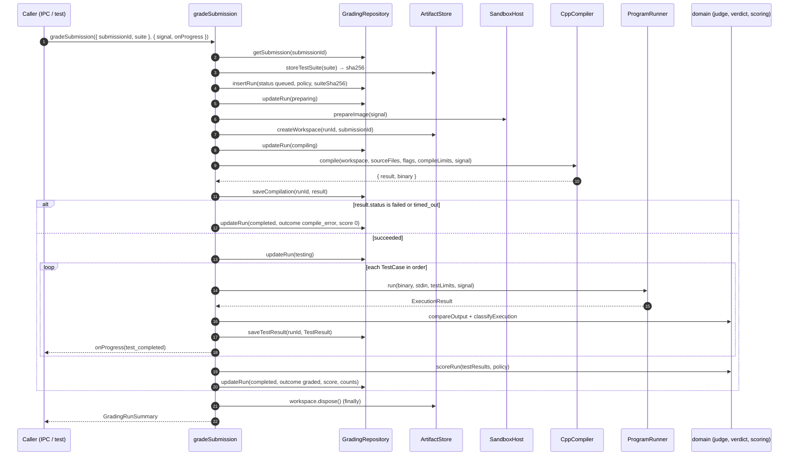
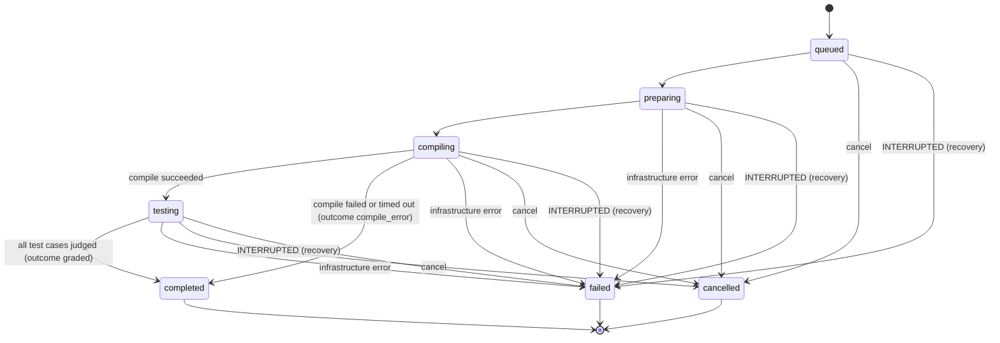
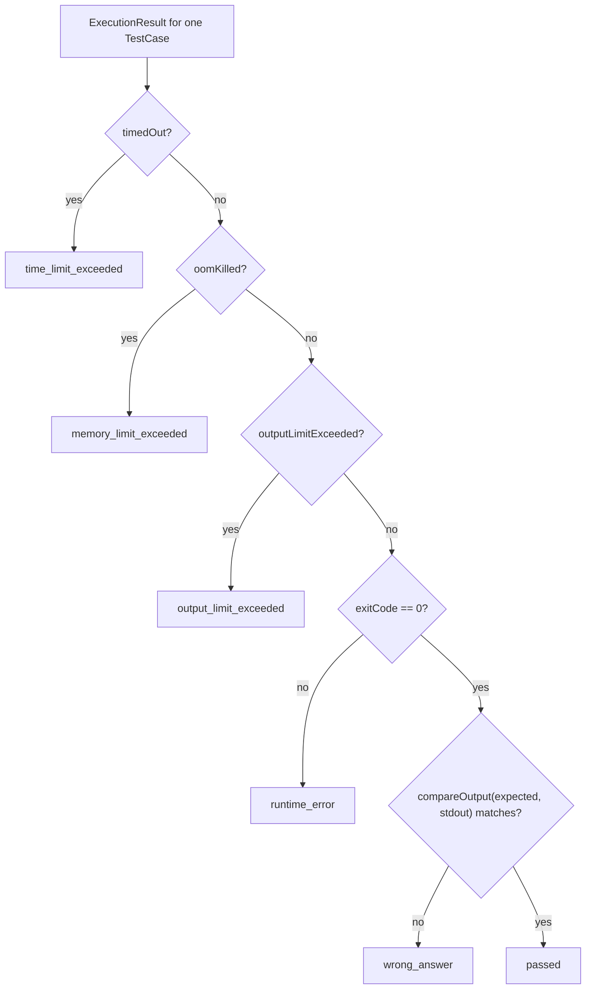
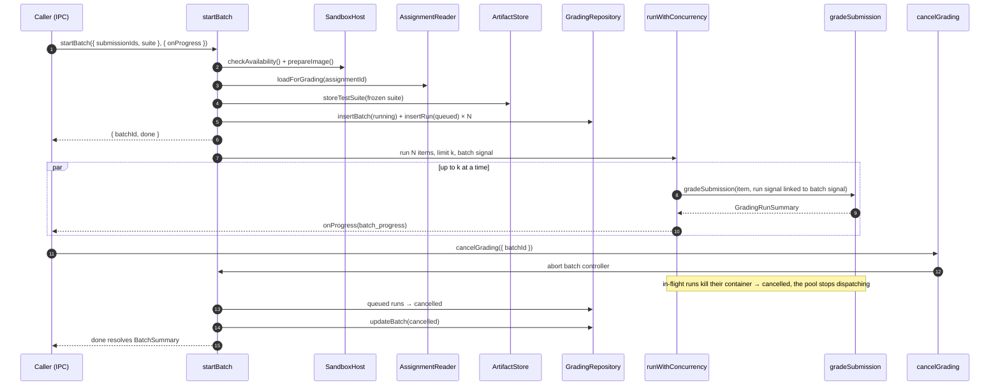
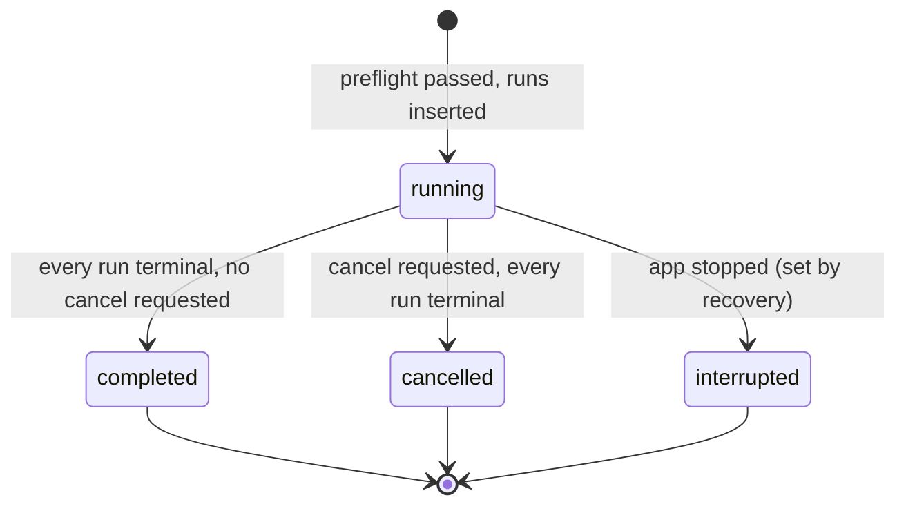

# 04 — C++ Grading Engine Design

> Terminology follows the [glossary](README.md#glossary). Components and ports are defined in [03](03-target-architecture.md).

## 1. Separation of responsibilities

| Concern               | Owner                                                            | Knows about                                               | Does **not** know about                     |
| --------------------- | ---------------------------------------------------------------- | --------------------------------------------------------- | ------------------------------------------- |
| **Orchestration**     | `application/gradeSubmission`, `application/startBatch`          | step order, state transitions, persistence calls, cleanup | Docker flags, `g++`, filesystem layout, SQL |
| **Compilation**       | `CppCompiler` → `dockerCppCompiler`                              | `g++` command line, compile container mounts              | test cases, scores                          |
| **Execution**         | `ProgramRunner` → `dockerProgramRunner`                          | running one binary with one stdin under limits            | expected output, verdicts                   |
| **Judging**           | `domain/judge.compareOutput`, `domain/verdict.classifyExecution` | output normalisation, verdict rules                       | containers, processes                       |
| **Scoring**           | `domain/scoring.scoreRun`                                        | the policy and test results                               | everything else                             |
| **Sandbox mechanics** | `dockerCli`, `sandboxPolicy`                                     | `docker create/start/inspect/kill/rm`, labels, caps       | C++, grading                                |

## 2. Lifecycle

| #   | Step                                                                                                                                                                                                                                                                                                         | Component                                               | Persisted                      | On failure                                                                                             |
| --- | ------------------------------------------------------------------------------------------------------------------------------------------------------------------------------------------------------------------------------------------------------------------------------------------------------------ | ------------------------------------------------------- | ------------------------------ | ------------------------------------------------------------------------------------------------------ |
| 1   | **Validate the submission**: at least one implementation file (`.cpp .cc .cxx .cp`), extension allowlist (adds `.h .hpp`), per-file ≤ 500 KB (current limit in `createSubmission()`), proposed ≤ 50 files and ≤ 5 MB total, regular files only (`lstat`, symlinks rejected), sanitised unique relative paths | `createSubmission` + `fsArtifactStore`                  | —                              | `GradingError(validation)`; nothing stored                                                             |
| 2   | **Create an immutable snapshot**: copy to `artifacts/submissions/<submissionId>/src/`, sha256 each file and the manifest, write `manifest.json` (v2), mark the files read-only, insert a `submission_snapshots` row                                                                                          | `createSubmission`                                      | yes                            | Copy or DB failure → delete the partial directory, `WORKSPACE_IO` / `PERSISTENCE_FAILED`               |
| 3   | **Prepare an isolated workspace**: insert `grading_runs` (`queued`), move to `preparing`, run `SandboxHost.prepareImage()` (pull outside every timer), create `tmp/batchgrade/runs/<runId>/{src,build}` and copy the snapshot into `src/`                                                                    | `gradeSubmission`, `ArtifactStore.createWorkspace`      | run row                        | `IMAGE_UNAVAILABLE` / `WORKSPACE_IO` → run `failed`                                                    |
| 4   | **Compile once**: move to `compiling`, call `CppCompiler.compile()` with all implementation files from `sourceDir` and output `build/program`                                                                                                                                                                | `dockerCppCompiler`                                     | —                              | see [§6.1](#61-compilation-failure)                                                                    |
| 5   | **Capture diagnostics**: store `CompilationResult` (stdout/stderr inline up to 64 KiB; the full captured log goes to `artifacts/runs/<runId>/compile.log` if longer)                                                                                                                                         | `gradeSubmission` → `GradingRepository.saveCompilation` | `compilation_results`          | —                                                                                                      |
| 6   | **Execute against each test case**: move to `testing`. For each test case in `order`, **sequentially**, call `ProgramRunner.run()`                                                                                                                                                                           | `dockerProgramRunner`                                   | —                              | see [§6](#6-failure-behaviour)                                                                         |
| 7   | **Enforce resource limits**: wall time, memory, CPU, pids, output cap, file size, tmpfs size (values in [03 §7.1](03-target-architecture.md#71-core-domain-types), flags in [06 §4](06-security.md#4-security-controls))                                                                                     | `sandboxPolicy` + `dockerCli`                           | —                              | Limit hits resolve as verdicts, not errors                                                             |
| 8   | **Compare output**: `compareOutput(expected, actual, policy.compareMode)` and then `classifyExecution()`                                                                                                                                                                                                     | domain                                                  | —                              | —                                                                                                      |
| 9   | **Calculate results and score** after the last test: `scoreRun(testResults, policy)`                                                                                                                                                                                                                         | domain                                                  | —                              | —                                                                                                      |
| 10  | **Persist outcomes**: each `TestResult` is saved as soon as it is known; the final `status=completed`, `outcome`, `score`, `passedCount`, `totalCount` are written in one transaction                                                                                                                        | `GradingRepository`                                     | `test_results`, `grading_runs` | `PERSISTENCE_FAILED` → run `failed`                                                                    |
| 11  | **Report progress**: `onProgress` on every status change and every finished test                                                                                                                                                                                                                             | `gradeSubmission`                                       | —                              | Listener errors are swallowed and logged                                                               |
| 12  | **Clean up**: adapters remove their own containers (`rm -f` in `finally`); `gradeSubmission` calls `workspace.dispose()` in `finally`; `runRegistry` unregisters the run                                                                                                                                     | all                                                     | —                              | Cleanup errors are logged; the startup sweep catches leftovers ([§9](#9-retry-and-recovery-semantics)) |

The Docker image is never cached between machines or across reinstalls. The binary is never kept after the run ends.

## 3. Sequence: grade one submission



## 4. Grading-run state machine



Invariants (enforced by `domain/gradingRun.transition()` and by `GradingRepository`):

- `completed`, `failed`, and `cancelled` are terminal. A run is never reopened; regrading creates a new run.
- `outcome`, `score`, `passedCount`, and `totalCount` are non-null **only** when `status = completed`.
- `errorCode` is non-null **only** when `status = failed`.
- A `compile_error` run has `score = 0`, `passedCount = 0`, `totalCount = <suite size>`, and no `test_results` rows.

## 5. Verdict classification



- `skipped` is never produced by `classifyExecution`. It is assigned by the orchestrator to test cases that did not run because the run was cancelled.
- The order of the checks matters. A program killed by our timer exits with code 137, so `timedOut` must be checked before `exitCode`.
- `normalized` comparison is `cleanOutput()` from `src/main/compiler/dockerJudge.ts`, unchanged: trim both ends, CRLF/CR → LF, then remove trailing newlines. Other modes are **open decision D11**.
- `passed` requires exit code 0. This preserves today's rule that `passed = success && outputMatches` (FR-7).
- stderr is captured and stored but never compared.

## 6. Failure behaviour

### 6.1 Compilation failure

- **Non-zero `g++` exit** gives `CompilationResult.status = 'failed'` and the run ends `completed` with `outcome = compile_error` and score 0 (FR-9). The diagnostics are stored and shown to the user.
- **Compile wall-time exceeded** (60 s default, measured from `docker start`, so it never includes the image pull) gives `status = 'timed_out'` and the same `compile_error` outcome. This is attributed to the student, because a template or `constexpr` bomb is student-caused.
- **Compile container OOM-killed** (`g++` fatal "killed signal") gives `status = 'failed'` with the stderr captured. The outcome is `compile_error`.
- **Exit code 0 but `build/program` is missing** is `infrastructure/SANDBOX_STATE_UNKNOWN` and the run `failed`.
- **A container that cannot be created or started** is `CONTAINER_START_FAILED`, retried once ([§9](#9-retry-and-recovery-semantics)).

### 6.2 Runtime errors

A non-zero exit code or a fatal signal (for example 139 = SIGSEGV, 134 = SIGABRT) gives `runtime_error`. The exit code is stored. The UI may show a friendly signal name derived from `exitCode - 128`. The remaining test cases **still run**, because each test case is independent.

### 6.3 Timeouts

- A per-test wall-clock timer runs in Node from `docker start` to container exit. The default is 5 000 ms, matching the previous Grading+ flow; `TestCase.timeoutMs` overrides it.
- When the timer fires, the adapter runs `docker kill <id>` (SIGKILL), waits for exit, records `timedOut = true`, and keeps the output captured so far.
- Only wall time is enforced. CPU-time limits are not, because `--cpus 1` throttles CPU usage but does not cap total CPU time. This trade-off is stated in [06 §8](06-security.md#8-residual-risks).

### 6.4 Memory and output limits

- **Memory**: `--memory`/`--memory-swap` are equal (no swap). If the kernel OOM-kills the program, `docker inspect` reports `State.OOMKilled = true` and the verdict is `memory_limit_exceeded`. P3a must verify that `OOMKilled` is reported reliably with `--init` on cgroup v1 and v2. If it is not, the documented fallback is to classify as `runtime_error` with exit code 137.
- **Output**: once either stream exceeds `outputCaptureBytes`, the adapter stops reading, kills the container, and sets `outputLimitExceeded`. The text captured so far is kept, with `truncated = true`.
- **Files**: writes beyond `--ulimit fsize` or beyond the tmpfs size fail inside the program with `EFBIG` or `ENOSPC`. They usually surface as `runtime_error`.

### 6.5 Cancellation

| Run state when cancelled | Effect                                                                                                                                                                                               |
| ------------------------ | ---------------------------------------------------------------------------------------------------------------------------------------------------------------------------------------------------- |
| `queued`                 | Moves to `cancelled`. No container is created.                                                                                                                                                       |
| `preparing`              | The image pull is aborted (the pull process is killed; Docker may finish the layer download in the background). The workspace is disposed. The run is `cancelled`.                                   |
| `compiling`              | The compile container is killed and removed. The workspace is disposed. The run is `cancelled`.                                                                                                      |
| `testing`                | The current test container is killed and removed. The current and every remaining test case are recorded as `skipped`. Results that already finished are kept. The run is `cancelled`. **No score.** |
| terminal                 | No-op. Returns the current status.                                                                                                                                                                   |

Cancellation works through an `AbortController` per run, held in `runRegistry`. The controller of a batch is linked to each run's controller, so aborting the batch aborts all of them. Each adapter listens to `signal` and reacts within one `docker kill` round-trip.

## 7. Batch scheduling and bounded concurrency

### 7.1 Rules

1. **Preflight** (before any run row is created): `SandboxHost.checkAvailability()` must return `ready`, then `prepareImage()` runs once. If preflight fails, `startBatch` rejects with `DOCKER_UNAVAILABLE` / `IMAGE_UNAVAILABLE`, and no batch is created.
2. **Freeze the test suite once per batch.** It is loaded through `AssignmentReader` (or taken from the ad-hoc cases), written by `storeTestSuite`, and every run in the batch references the same `suiteSha256` and policy snapshot. Editing the assignment's test cases during a batch does not affect it.
3. **The unit of concurrency is the `GradingRun`.** Test cases inside a run are sequential. Each container is limited to one CPU, so `concurrency` is roughly the number of CPU cores in use.
4. **Concurrency limit**: `min(requested ?? default, max(1, os.availableParallelism() - 1))`. The default is **open decision D1**; the proposal is 2 until PERF-1 data exists. Memory needed is about `concurrency × memoryMb` plus Docker Desktop VM overhead.
5. **FIFO dispatch** in input order. Runs complete out of order. Results are persisted per run as each one finishes.
6. **Isolation between runs**: one run failing (any status) never stops the others, with two exceptions, which act as **circuit breakers**:
   - `DOCKER_UNAVAILABLE` mid-batch: Docker is gone, so every queued run is marked `failed` with that code instead of each one waiting for a timeout.
   - `PERSISTENCE_FAILED`: results can no longer be recorded, so the batch stops in the same way.
7. Implementation: `runWithConcurrency(items, limit, worker, signal)` is a promise pool of about 20 lines in `application/`. It has no dependency ([ADR-0005](adr/0005-orchestration-and-concurrency.md)).

### 7.2 Sequence: batch with cancellation



### 7.3 Batch state machine



A `completed` batch may contain `failed` runs. The batch summary reports counts by run status and outcome.

## 8. Infrastructure failure handling

| Failure                                               | Detected by                              | Result                                                                                      |
| ----------------------------------------------------- | ---------------------------------------- | ------------------------------------------------------------------------------------------- |
| Docker CLI missing / daemon down **before** the batch | preflight                                | `startBatch` rejects with `DOCKER_UNAVAILABLE`; nothing persisted                           |
| Daemon lost **during** the batch                      | `dockerCli` spawn/exit errors            | current run `failed`; circuit breaker fails the queued runs                                 |
| Image not present and pull fails (offline)            | `prepareImage`                           | `IMAGE_UNAVAILABLE`; the UI tells the user to connect once, or to load the image (D6)       |
| `docker create`/`start` fails                         | `dockerCli`                              | `CONTAINER_START_FAILED`, retried once, then the run is `failed`                            |
| `docker inspect` fails after the program ran          | `dockerCli`                              | `SANDBOX_STATE_UNKNOWN`, run `failed` (no guessing of verdicts)                             |
| `docker rm -f` fails                                  | `dockerCli` `finally`                    | Logged; the container is labelled, so the startup sweep removes it                          |
| Workspace copy / disk full                            | `fsArtifactStore`                        | `WORKSPACE_IO`, run `failed`                                                                |
| SQLite write fails                                    | repository                               | `PERSISTENCE_FAILED`, run `failed` if recordable, circuit breaker for the batch             |
| Unexpected exception (bug)                            | `gradeSubmission` catch-all              | `INTERNAL`, run `failed`, stack logged                                                      |
| App quits during a batch                              | Electron `before-quit` (interface layer) | `registry.abortAll()` with a short grace period; anything unfinished is handled by recovery |

## 9. Retry and recovery semantics

**Automatic retry:**

- Only `CONTAINER_START_FAILED` is retried: **once**, after 1 s (proposal), and only before the student program has started. This is safe because nothing student-controlled has run yet.
- Student outcomes (any verdict, compile errors) are **never** retried. Re-running a program that timed out is not a fix, and repeated runs could hide flakiness in the program.

**Manual retry (regrade):**

- Grading the same submission again creates a **new** `GradingRun`. The old run stays as history (FR-16).
- "Retry failed runs" in a batch = `startBatch` with the `submissionId`s whose latest run is `failed`. This produces a new batch with the same suite reference.
- Which run counts as the official grade is **open decision D4**. The proposal is the most recent `completed` run per (assignment, studentRef).

**Recovery at startup** (`recoverInterruptedWork`, called from `src/main/index.ts` after the database opens and after `app.requestSingleInstanceLock()` succeeds):

1. `GradingRepository.failNonTerminalRuns('INTERRUPTED')` moves every `queued`/`preparing`/`compiling`/`testing` run to `failed`, and every `running` batch to `interrupted`.
2. `ArtifactStore.sweepWorkspaces()` removes `tmp/batchgrade/runs/*`.
3. `SandboxHost.removeOrphans()` removes containers labelled `batchgrade.managed=true`. If Docker is not running at startup, this step is deferred until the first successful `checkAvailability()`, and it always runs before any new run starts.

Recovery never resumes a half-finished run. Partial state (such as completed test results of an interrupted run) is kept for diagnosis but carries no score.

## 10. Progress reporting

```ts
type GradingProgressEvent =
  | {
      type: 'run_status_changed'
      runId: string
      batchId: string | null
      status: RunStatus
      outcome?: RunOutcome
    }
  | { type: 'test_completed'; runId: string; order: number; verdict: Verdict; durationMs: number }
  | { type: 'batch_progress'; batchId: string; total: number; byStatus: Record<RunStatus, number> }
```

- Events are emitted synchronously by the use cases. The IPC adapter coalesces them per run (PERF-4) and sends them through `webContents.send('grading:progress', event)`.
- Progress is best-effort. The persisted state is the source of truth, and a UI that reconnects calls `grading:getResults`.

## 11. Cleanup guarantees

| Resource                           | Created by                      | Released by                                         | Backstop                       |
| ---------------------------------- | ------------------------------- | --------------------------------------------------- | ------------------------------ |
| Compile/test container             | `dockerCli.create`              | `dockerCli` `finally { rm -f }`                     | label sweep at startup         |
| Workspace directory                | `ArtifactStore.createWorkspace` | `gradeSubmission` `finally { workspace.dispose() }` | `sweepWorkspaces()` at startup |
| Child `docker` CLI processes       | `dockerCli`                     | killed on timeout or abort, awaited on exit         | process exit                   |
| AbortController                    | `runRegistry.register`          | `runRegistry.unregister` in `finally`               | —                              |
| Submission snapshot, run artifacts | `ArtifactStore`                 | kept as history (retention is **open decision D5**) | —                              |

This replaces the `process.once('exit')` cleanup sets in `dockerCompile.ts` and `dockerExecute.ts` (W9).
