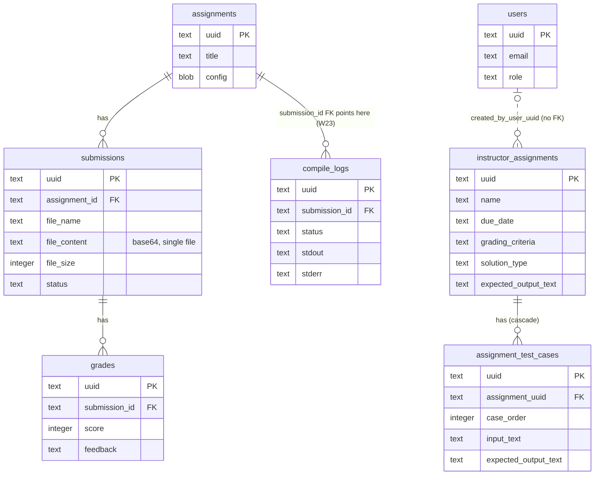
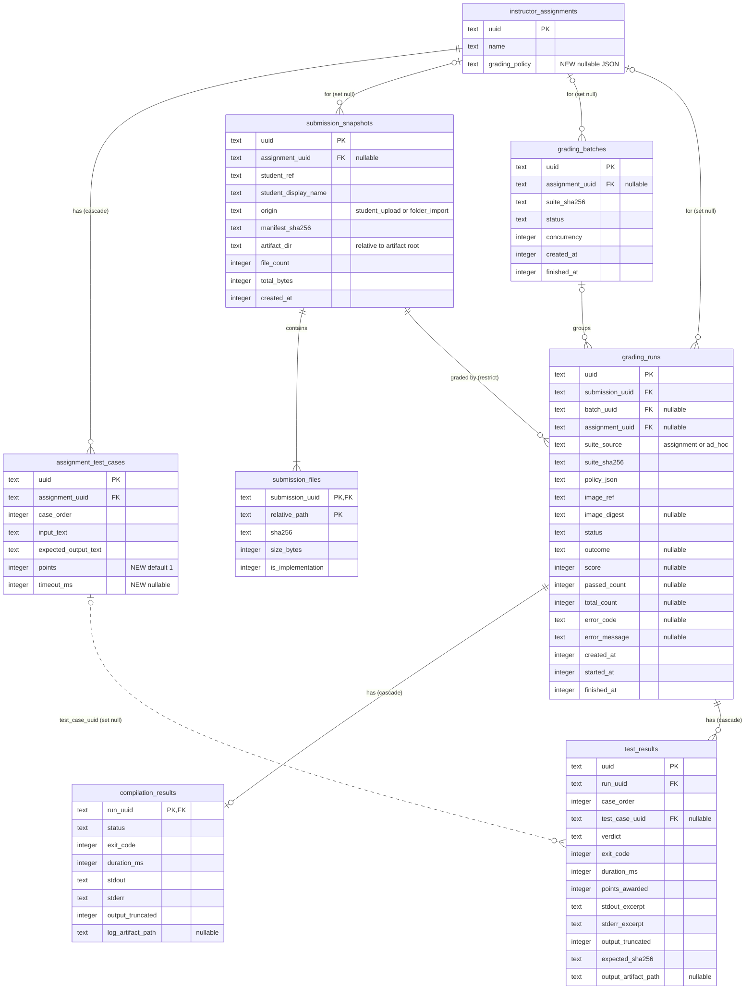

# 05 — Domain and Persistence Design

> Terminology follows the [glossary](README.md#glossary). Run states and verdicts are defined in [04](04-grading-workflow.md).

## 1. Domain entities

| Entity                 | Meaning                                                                                          | Lifecycle                                                     | Persisted as                                                                             |
| ---------------------- | ------------------------------------------------------------------------------------------------ | ------------------------------------------------------------- | ---------------------------------------------------------------------------------------- |
| **Assignment**         | Instructor-defined exercise with a test suite and an optional grading policy                     | mutable (CRUD)                                                | `instructor_assignments` (kept)                                                          |
| **TestCase**           | One stdin / expected-output pair with an order, points and an optional time limit                | mutable; replaced wholesale by `replaceAssignmentTestCases()` | `assignment_test_cases` (kept)                                                           |
| **TestSuite**          | The ordered, **frozen** set of test cases a run is graded against (from an assignment or ad hoc) | immutable, content-addressed by sha256                        | `artifacts/test-suites/<sha256>.json`                                                    |
| **GradingPolicy**      | Compare mode, compiler flags, resource limits, scoring rule                                      | immutable once copied into a run                              | `instructor_assignments.grading_policy` (defaults) → `grading_runs.policy_json` (frozen) |
| **Submission**         | Immutable snapshot of one student's source files for one assignment                              | immutable                                                     | `submission_snapshots` + `submission_files` + `artifacts/submissions/<id>/`              |
| **GradingBatch**       | A group of runs started together against one TestSuite                                           | `running → completed \| cancelled \| interrupted`             | `grading_batches`                                                                        |
| **GradingRun**         | One attempt to grade one Submission against one TestSuite under one GradingPolicy                | [04 §4](04-grading-workflow.md#4-grading-run-state-machine)   | `grading_runs`                                                                           |
| **CompilationResult**  | Outcome and diagnostics of the run's single compilation                                          | written once                                                  | `compilation_results`                                                                    |
| **ExecutionResult**    | Raw outcome of running the binary on one TestCase                                                | transient (an input to the verdict)                           | folded into `test_results`                                                               |
| **TestResult**         | Verdict and evidence for one TestCase in one run                                                 | written once                                                  | `test_results`                                                                           |
| **Grade** (read model) | The score shown in the gradebook for (assignment, student)                                       | derived                                                       | query over `grading_runs` ([§7](#7-grades-and-feedback))                                 |

Students are referenced by an opaque `studentRef`. When the submitter is a logged-in user, `studentRef` is `users.uuid`. When the submission comes from a folder import, it is the folder name. There is deliberately **no foreign key** to `users`, because batch imports have no user rows (EX-3).

## 2. Current model and its overlaps



There is also an on-disk model that the database does not know about: `userData/submissions/<studentId>/<assignmentId>/<ts>-<uuid>/submission-manifest.json` (manifest v1, written by `submitCppSubmission()`).

| Overlap                                    | Problem                                                                                                   | Resolution                                                                                      |
| ------------------------------------------ | --------------------------------------------------------------------------------------------------------- | ----------------------------------------------------------------------------------------------- |
| `assignments` vs `instructor_assignments`  | Two assignment identities. Grades hang off the stub table, test cases off the real one.                   | `instructor_assignments` is the only Assignment. `assignments` is frozen, then dropped (P8).    |
| `submissions` table vs manifest v1 on disk | One stores a single base64 file, the other multiple files without hashes. Neither has a student column.   | Replaced by `submission_snapshots` + `submission_files` + the artifact directory (manifest v2). |
| `grades` vs `GradebookRecord`              | The writer fabricates `assignments`/`submissions` rows. The reader loses counts and the student ID (W22). | The grade becomes a **read model** over `grading_runs`. `grades` is frozen, then dropped.       |
| `compile_logs`                             | Wrong foreign key, never written                                                                          | Replaced by `compilation_results`. Dropped in P8.                                               |

## 3. Target model



**Indexes:** `submission_snapshots(assignment_uuid, student_ref)`, `grading_runs(submission_uuid)`, `grading_runs(batch_uuid)`, `grading_runs(assignment_uuid, status, finished_at)`, unique `test_results(run_uuid, case_order)`.

**Why `submission_snapshots` and not `submissions`:** the legacy `submissions` table is still read during the transition (expand/contract), so the new table needs a different name. The domain name is still **Submission**.

## 4. Invariants

| ID  | Invariant                                                                                                                                                         | Enforced by                                                      |
| --- | ----------------------------------------------------------------------------------------------------------------------------------------------------------------- | ---------------------------------------------------------------- |
| I1  | A Submission never changes after creation. Its files are written once and marked read-only. A new upload is a new Submission.                                     | `createSubmission`, `fsArtifactStore`; no update query exists    |
| I2  | `manifest_sha256 = sha256(canonical JSON of [{relativePath, sha256}] sorted by relativePath)`                                                                     | `fsArtifactStore`                                                |
| I3  | `submission_files.relative_path` is sanitised (`safePaths`), uses forward slashes, is unique per submission, is not absolute, and contains no `..`                | `safePaths`, primary key                                         |
| I4  | At least one `submission_files` row per Submission has `is_implementation = 1`                                                                                    | `createSubmission` validation                                    |
| I5  | `outcome`, `score`, `passed_count`, and `total_count` are non-null only when `status = 'completed'`. `error_code` is non-null only when `status = 'failed'`.      | `domain/gradingRun`, repository, plus SQLite `CHECK` constraints |
| I6  | `outcome = 'compile_error'` ⇒ `compilation_results.status ∈ {failed, timed_out}`, `score = 0`, `passed_count = 0`, no `test_results`                              | `gradeSubmission`                                                |
| I7  | `outcome = 'graded'` ⇒ exactly `total_count` `test_results` rows, `passed_count = count(verdict = 'passed')`                                                      | `gradeSubmission` (one transaction)                              |
| I8  | `suite_sha256` identifies the frozen suite file `artifacts/test-suites/<suite_sha256>.json`                                                                       | `fsArtifactStore.storeTestSuite`                                 |
| I9  | `suite_source = 'ad_hoc'` ⇔ `assignment_uuid IS NULL` on the run                                                                                                  | repository                                                       |
| I10 | All stored paths are relative to the artifact root and use forward slashes                                                                                        | `fsArtifactStore`                                                |
| I11 | Deleting an assignment keeps grading history: snapshots, batches and runs get `assignment_uuid = NULL`, and the frozen suite file keeps the history interpretable | foreign keys `ON DELETE SET NULL`                                |
| I12 | A Submission that has runs cannot be deleted                                                                                                                      | foreign key `ON DELETE RESTRICT`                                 |

`test_results.test_case_uuid` is informational and nullable (`ON DELETE SET NULL`), because `replaceAssignmentTestCases()` deletes and re-inserts rows with new UUIDs. `case_order` together with `suite_sha256` is the stable identity of a test case within a run.

## 5. Grading policy storage

- `instructor_assignments.grading_policy` holds a **partial** policy as JSON (for example `{ "testLimits": { "wallTimeMs": 2000 } }`). A null value means "use the defaults".
- When a run is created, the effective policy (`defaults ⊕ assignment overrides ⊕ per-test timeouts`) is serialised **completely** into `grading_runs.policy_json`. Later changes to the defaults or to the assignment therefore never change how an earlier run is interpreted.
- The column is JSON rather than separate columns because policy fields will change as open decisions D2, D9 and D11 are resolved. The engine only reads it through `domain/` parsing with defaults.

## 6. SQLite vs filesystem artifact storage

| Data                                                                     | Store                                                            | Reason                                                                                           |
| ------------------------------------------------------------------------ | ---------------------------------------------------------------- | ------------------------------------------------------------------------------------------------ |
| Metadata, status, scores, verdicts, hashes, timestamps                   | SQLite                                                           | Queried by the gradebook; small; needs transactions                                              |
| Compiler and program output **excerpts** (≤ 64 KiB per stream, proposed) | SQLite                                                           | Shown directly in the UI without file I/O                                                        |
| Full captured output beyond the excerpt (≤ 1 MiB capture cap, proposed)  | Filesystem                                                       | Rarely read; keeps the database small                                                            |
| Submission source files                                                  | Filesystem                                                       | Multi-file trees; must be copied into workspaces; hashed                                         |
| Frozen test suites                                                       | Filesystem (content-addressed, de-duplicated)                    | Shared by every run in a batch; can be large                                                     |
| Compiled binaries                                                        | **Not stored**                                                   | Rebuilt from the snapshot and the pinned image when needed; avoids keeping untrusted executables |
| Expected output used for authoring                                       | SQLite (`assignment_test_cases.expected_output_text`, unchanged) | Existing CRUD; the frozen copy lives in the suite file                                           |

**Artifact root layout** (root injected; desktop default `app.getPath('userData')/artifacts`):

```text
artifacts/
  submissions/<submissionId>/manifest.json          # manifest v2 (superset of v1 + sha256 per file)
  submissions/<submissionId>/src/<relative path>    # read-only copies
  test-suites/<sha256>.json                         # canonical frozen TestSuite
  runs/<runId>/compile.log                          # only when output exceeded the excerpt
  runs/<runId>/tests/<order>.stdout|.stderr         # only when output exceeded the excerpt
```

**Workspaces are not artifacts.** They live under `os.tmpdir()/batchgrade/runs/<runId>/` and are deleted when the run ends ([04 §11](04-grading-workflow.md#11-cleanup-guarantees)).

## 7. Grades and feedback

The gradebook reads a **derived view**, not a table that someone writes to:

- **Grade** for (assignment, studentRef) is the most recent `grading_runs` row with `status = 'completed'` for a Submission with that `assignment_uuid` and `student_ref`. Whether an instructor can pin a different run, or override the score, is **open decision D4**.
- **Mapping to the existing `GradebookRecord` DTO** (`src/shared/gradebookTypes.ts`):
  - `studentId ← student_ref`
  - `studentName ← student_display_name`
  - `score`, `passedCount`, `totalCount` are taken directly, which fixes the zeros returned today (W22)
  - `status ← 'done'` for `graded`, `'failed'` for `compile_error`
  - `feedback ← "<passed>/<total> test cases passed."` (the current default text from `createGradebookRecord()`), or `"Compilation failed."`
  - `submittedAt ← submission_snapshots.created_at`, `gradedAt ← finished_at`
- Runs that are `failed` or `cancelled` **never** appear as grades (REL-1). The UI shows them as "needs regrade".
- Per-test feedback is the list of `test_results` (verdict, duration, output excerpts). The expected output is shown from the frozen suite.

## 8. Historical runs and reproducibility

A run can be re-executed under the same conditions from:

1. the Submission (`manifest_sha256` verifies the files are unchanged),
2. the frozen TestSuite (`suite_sha256`),
3. `policy_json` (flags and limits),
4. `image_ref` + `image_digest` (exact compiler and runtime).

Limits on reproducibility, stated plainly: wall-clock timeouts depend on host load, programs with undefined behaviour may behave differently between runs, and if the image digest is not pinned (open decision D6), `gcc:14` can change underneath. Reproducibility is therefore "same inputs, same environment", not a guaranteed identical verdict.

## 9. Migration strategy

The migration follows the **expand → migrate → contract** pattern, phased as in [07](07-migration-plan.md):

| Step | Phase  | Change                                                                                                                                                                                                                                                                                                                                                                                                                                         | Reversible?               |
| ---- | ------ | ---------------------------------------------------------------------------------------------------------------------------------------------------------------------------------------------------------------------------------------------------------------------------------------------------------------------------------------------------------------------------------------------------------------------------------------------- | ------------------------- |
| 0    | P5a    | **Repair migration metadata** (W24). (1) Apply `0000`–`0002` to a fresh database. (2) Run `drizzle-kit generate` with the current schema. It will propose a migration because `0002_snapshot.json` is missing. (3) Keep **only** the generated snapshot, saved as `meta/0002_snapshot.json` with a corrected `prevId` chain, and discard the generated SQL and journal entry. (4) Running `drizzle-kit generate` again must report no changes. | yes (metadata only)       |
| 1    | P5b    | **Expand**: migration `0003` adds the new tables and the new nullable/defaulted columns (`grading_policy`, `points`, `timeout_ms`). Additive only; no drops, no renames.                                                                                                                                                                                                                                                                       | yes (drop the new tables) |
| 2    | P5b–P7 | **Dual read**: the engine writes only the new tables. The gradebook read path returns new-model grades **plus** legacy `grades` rows labelled `scoreSource: 'legacy'`. `gradebook:create` keeps writing legacy tables for any caller that has not migrated yet.                                                                                                                                                                                | yes                       |
| 3    | —      | **No automatic data conversion.** Legacy `grades` rows lack per-test data and real student IDs, so converting them would invent data. v1 manifests on disk stay where they are; regrading one goes through `createSubmission` like any new upload.                                                                                                                                                                                             | —                         |
| 4    | P8     | **Contract**: migration `0004` drops `assignments`, `submissions`, `grades`, `compile_logs` after at least one release that offers a legacy export (retention: open decision D5). Renaming `instructor_assignments` is open decision D10 and is **not** bundled into this step.                                                                                                                                                                | no (needs a backup)       |

Migration safety rules:

- Every new migration's journal `when` must be greater than every existing entry. The current journal is out of order (`0001` < `0000`), and Drizzle's migrator compares timestamps with the last applied migration, so a migration with a lower `when` could be skipped silently on databases that are already deployed. Verify this behaviour against `drizzle-orm`'s migrator during P5a.
- Migrations are tested against both a fresh database **and** a database copied from the previous release.
- The existing test harness (`tests/setup.ts`) already applies all migrations to an in-memory database, so every schema change is exercised by the existing tests.
