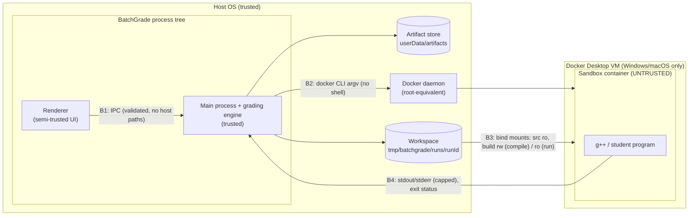

# 06 — Threat Model and Execution Isolation

> Terminology follows the [glossary](README.md#glossary). Weakness IDs (W*) are from [01](01-current-state.md#6-architectural-weaknesses-and-technical-debt). Requirement IDs (SEC-*) are from [02](02-requirements.md#5-security).

## 1. Stance

Every C++ submission, and every binary built from it, is **hostile code**. The design layers several independent controls so that no single control failing exposes the host.

**Ordinary Docker isolation is not a complete security boundary.**

- On Linux, containers share the host kernel. A kernel or container-runtime vulnerability can lead to a container escape.
- On Windows and macOS, Docker Desktop runs containers inside a Linux VM. The VM is an extra layer, but bind mounts, the VM's kernel and Docker Desktop itself are still attack surface.

The controls below reduce the probability and the impact of an escape. They do not eliminate it. For the desktop product, the instructor accepts this residual risk by running student code on their own machine, and the UI and documentation should say so. A public, multi-tenant deployment needs a stronger boundary ([§7](#7-desktop-vs-public-multi-tenant-deployment)).

## 2. Assets and adversaries

| Asset                                                              | Why it matters                                      |
| ------------------------------------------------------------------ | --------------------------------------------------- |
| Instructor's host filesystem (home directory, SSH keys, documents) | Confidentiality, integrity                          |
| Other students' submissions and the expected outputs               | Academic integrity                                  |
| Grading results database                                           | Integrity                                           |
| Host availability (CPU, memory, disk)                              | The batch must finish; the machine must stay usable |
| Docker daemon                                                      | Root-equivalent on Linux                            |

| Adversary                     | Capability                                                                                                                               |
| ----------------------------- | ---------------------------------------------------------------------------------------------------------------------------------------- |
| **A1 — Malicious student**    | Controls source code, file names and directory structure of a submission; indirectly controls the program's runtime behaviour and output |
| **A2 — Curious student**      | Wants to read expected outputs or other students' code                                                                                   |
| **A3 — Compromised renderer** | XSS-like bug or malicious content in the UI. Can call any IPC channel exposed to it (W2).                                                |
| Out of scope                  | A malicious instructor or a local administrator on their own machine                                                                     |

## 3. Trust boundaries



| Boundary                   | What crosses it            | Controls                                                                                                                        |
| -------------------------- | -------------------------- | ------------------------------------------------------------------------------------------------------------------------------- |
| **B1** renderer → main     | IPC payloads               | Validated type guards; opaque selection IDs instead of host paths (SEC-5); stop exposing raw `window.electron.ipcRenderer` (W2) |
| **B2** main → Docker       | `docker` argv              | `spawn` with argument arrays, no shell; engine-generated IDs only; source paths prefixed with `./`                              |
| **B3** host fs ↔ container | Workspace directories only | Per-run workspace copies; read-only where possible; never user-selected directories (SEC-3)                                     |
| **B4** container → main    | Output bytes, exit status  | Byte caps with kill (SEC-4); output treated as untrusted text in the UI                                                         |

## 4. Security controls

### 4.1 Container flags

All flags are produced by `infrastructure/docker/sandboxPolicy.ts` from `ResourceLimits`. Default values are in [03 §7.1](03-target-architecture.md#71-core-domain-types). Values marked † are proposals that need measurement or platform verification in P3b.

**Compile container**:

```text
docker create
  --label batchgrade.managed=true --label batchgrade.run=<runId> --label batchgrade.role=compile
  --init
  --network none
  --cap-drop ALL
  --security-opt no-new-privileges
  --read-only
  --tmpfs /tmp:rw,nosuid,nodev,size=64m                 †
  --pids-limit 16                                        †  (current: 5)
  --memory 256m --memory-swap 256m
  --cpus 1
  --ulimit core=0 --ulimit nofile=256 --ulimit fsize=67108864   †
  --user <uid>:<gid>                                     (see §4.3)
  -v <workspace>/src:/src:ro
  -v <workspace>/build:/build:rw
  -w /src
  <image>[@<digest>] g++ <policy flags> ./<file1> ./<file2> … -o /build/program
```

**Test container** (one per test case):

```text
docker create
  --label batchgrade.managed=true --label batchgrade.run=<runId> --label batchgrade.role=test
  --init -i
  --network none
  --cap-drop ALL
  --security-opt no-new-privileges
  --read-only
  --tmpfs /tmp:rw,nosuid,nodev,noexec,size=16m           †
  --tmpfs /work:rw,nosuid,nodev,noexec,size=16m          †  (replaces the host bind mount, W5)
  --pids-limit 5                                         (current)
  --memory 256m --memory-swap 256m
  --cpus 1
  --ulimit core=0 --ulimit nofile=64 --ulimit fsize=16777216    †
  --user <uid>:<gid>
  -v <workspace>/build:/app:ro
  -w /work
  <image>[@<digest>] /app/program
```

Lifecycle: `docker start -a [-i] <id>` (stdin piped, streams capped), then `docker inspect <id>` (exit code, `OOMKilled`), then `docker rm -f <id>` in `finally`. On timeout or abort, `docker kill <id>` runs first. See [ADR-0003](adr/0003-docker-sandbox-strategy.md).

No `-e` environment variables, no secrets, no Docker socket, and no host network are passed to any container. The Docker default seccomp profile and AppArmor profile (where available) stay enabled. The engine never passes `--privileged`, `seccomp=unconfined`, or `--cap-add`.

### 4.2 Filesystem and mounts

| Control                                        | Detail                                                                                                          | Fixes |
| ---------------------------------------------- | --------------------------------------------------------------------------------------------------------------- | ----- |
| Only per-run workspaces are mounted            | `sourceDir` is a **copy** of the snapshot; the user's original folders and the artifact store are never mounted | W3    |
| Read-only by default                           | Source is always `ro`; the build directory is `rw` only for compile and `ro` for tests                          | —     |
| No host-backed writable directory during tests | `/work` and `/tmp` are size-limited `tmpfs` with `noexec`                                                       | W5    |
| Read-only root filesystem                      | `--read-only` prevents modifying the image layer (for example replacing `/usr/bin` tools)                       | W6    |
| Expected output never enters a container       | Only stdin is piped in. Comparison happens in Node.                                                             | A2    |
| No cross-submission visibility                 | One workspace per run; no shared mounts between containers                                                      | A2    |

### 4.3 Non-root execution

| Host    | `--user`                                                                   | Notes                                                                                                                                                                                                                                                                                                             |
| ------- | -------------------------------------------------------------------------- | ----------------------------------------------------------------------------------------------------------------------------------------------------------------------------------------------------------------------------------------------------------------------------------------------------------------- |
| Linux   | host `uid:gid` (current behaviour); if the app runs as root, `65534:65534` | The bind-mounted build directory is owned by the host user, so writes work                                                                                                                                                                                                                                        |
| macOS   | host `uid:gid` (current behaviour)                                         | Docker Desktop file sharing maps ownership                                                                                                                                                                                                                                                                        |
| Windows | `65534:65534` (**new**; today containers run as root, W6)                  | Docker Desktop bind mounts from NTFS usually ignore POSIX ownership. **Must be verified (open decision D7)**. If the build directory is not writable for this user, do **not** fall back to root. The candidate alternative is a per-run named volume for `/build`, with the binary copied out using `docker cp`. |

### 4.4 Resource limits

| Resource              | Limit                                          | Mechanism                                | Verdict / effect                                        |
| --------------------- | ---------------------------------------------- | ---------------------------------------- | ------------------------------------------------------- |
| Wall time             | 5 s per test (current), 60 s compile (current) | Node timer → `docker kill`               | `time_limit_exceeded` / compile `timed_out`             |
| CPU                   | 1 core                                         | `--cpus 1` (CFS quota)                   | Throttling, not a kill                                  |
| Memory                | 256 MB, no swap                                | `--memory` = `--memory-swap`             | `memory_limit_exceeded`                                 |
| Processes and threads | 5 (run) / 16 (compile †)                       | `--pids-limit` (counts threads too)      | `fork()` / `std::thread` fail → usually `runtime_error` |
| Output to host        | 1 MiB per stream †                             | Node byte counter → `docker kill`        | `output_limit_exceeded`                                 |
| File size             | 16 MiB (run) / 64 MiB (compile) †              | `--ulimit fsize` (bytes, `RLIMIT_FSIZE`) | `EFBIG` / `SIGXFSZ` → `runtime_error`                   |
| Scratch disk          | 16 MiB `/work`, 16 MiB `/tmp` (run) †          | `tmpfs size=`                            | `ENOSPC`                                                |
| Open files            | 64 (run) / 256 (compile) †                     | `--ulimit nofile`                        | `EMFILE`                                                |
| Core dumps            | none                                           | `--ulimit core=0`                        | —                                                       |

`--pids-limit 5` also limits **threads**. A correct program that starts more than about three threads fails. This is today's behaviour. It is kept as the default and can be overridden per assignment through `GradingPolicy`.

### 4.5 Host-side and IPC controls

| Control                     | Detail                                                                                                                                                                                         | Fixes |
| --------------------------- | ---------------------------------------------------------------------------------------------------------------------------------------------------------------------------------------------- | ----- |
| Selection IDs               | Dialog results are stored in main (`ipc/fileSelections.ts`) and the renderer receives `{ selectionId, displayNames }`. Grading channels accept only selection IDs, submission IDs and run IDs. | W1    |
| Arbitrary file read removed | `file:stringify` is replaced by reading test-case files through selection IDs. The legacy channel is removed in P8.                                                                            | W1    |
| Narrow preload surface      | Stop exposing `@electron-toolkit/preload`'s `electronAPI` (raw `ipcRenderer`) and enable `sandbox: true` on the `BrowserWindow` (P7, verified with the renderer)                               | W2    |
| IDs in paths                | Only engine-generated UUIDs and `safePaths`-sanitised segments become path components; every resolved path is checked to stay inside its root                                                  | W7    |
| Symlinks                    | `lstat` every input file; reject anything that is not a regular file (SEC-7)                                                                                                                   | —     |
| Option injection            | Source files are passed as `./<relative path>`, so a file named `-fplugin=…cpp` cannot be read as a `g++` option                                                                               | —     |
| Untrusted output in the UI  | Rendered as plain text (React escaping; no `dangerouslySetInnerHTML`); ANSI escape sequences stripped or shown literally                                                                       | —     |
| Bounded memory in main      | Captured streams stop growing at the cap                                                                                                                                                       | W4    |

### 4.6 Container lifecycle and cleanup

- Every container is labelled `batchgrade.managed=true` and `batchgrade.run=<runId>`.
- `dockerCli` always runs `docker rm -f` in a `finally`, including after a timeout, a cancel, or a failed `inspect`.
- At startup, `recoverInterruptedWork` removes **all** labelled containers. This is safe only while one app instance runs, so P6 adds `app.requestSingleInstanceLock()`.
- Workspaces are deleted when the run ends and swept at startup.

## 5. Threat catalogue

| ID  | Threat                                                      | Adversary | Controls                                                                                                           | Residual                                                                                |
| --- | ----------------------------------------------------------- | --------- | ------------------------------------------------------------------------------------------------------------------ | --------------------------------------------------------------------------------------- |
| T1  | Container escape through a kernel or runtime vulnerability  | A1        | cap-drop ALL, no-new-privileges, default seccomp/AppArmor, non-root, read-only rootfs, no network                  | **Remains.** The kernel is shared (Linux) or the VM boundary is all there is (Desktop). |
| T2  | Abuse of the Docker daemon                                  | A1, A3    | No socket mount; argv arrays without a shell; the renderer cannot choose images, flags or mounts                   | Anyone in the `docker` group on Linux is root-equivalent, independent of BatchGrade     |
| T3  | Network exfiltration or attacks                             | A1        | `--network none`                                                                                                   | —                                                                                       |
| T4  | Fork bomb                                                   | A1        | `--pids-limit`                                                                                                     | —                                                                                       |
| T5  | Memory exhaustion                                           | A1        | `--memory` = `--memory-swap`                                                                                       | Concurrency × limit must fit Docker Desktop's VM memory                                 |
| T6  | Infinite loop, CPU hog                                      | A1        | `--cpus 1`, wall timer + `docker kill`                                                                             | —                                                                                       |
| T7  | Output flood exhausting main-process memory                 | A1        | Byte cap + kill                                                                                                    | —                                                                                       |
| T8  | Disk filling                                                | A1        | `--read-only`, tmpfs size, `--ulimit fsize`, no host-writable mount during tests; compile output capped by `fsize` | The image pull itself uses disk (about 1.4 GB)                                          |
| T9  | Reading host files at compile time (`#include "../../…"`)   | A1, A2    | Only the run's own copied sources are mounted (W3 fixed)                                                           | Files inside the image are readable (not sensitive)                                     |
| T10 | Reading other submissions or expected outputs               | A2        | One workspace per run; expected output never mounted                                                               | —                                                                                       |
| T11 | Path traversal, symlinks, zip-slip in submission files      | A1        | `safePaths`, `lstat`, root-containment check, UUID directories                                                     | —                                                                                       |
| T12 | File names injected as compiler options                     | A1        | `./` prefix on every source argument                                                                               | —                                                                                       |
| T13 | Renderer passes arbitrary host paths to mount or read       | A3        | Selection IDs, validation, narrow preload                                                                          | Legacy channels remain until P8                                                         |
| T14 | Orphaned containers keep consuming resources                | —         | Labels, `rm -f` in `finally`, startup sweep                                                                        | Containers from a crash run until the next app start                                    |
| T15 | Compiler bombs (template explosion, `#include "/dev/zero"`) | A1        | Compile memory, time and pids limits                                                                               | —                                                                                       |
| T16 | Image supply chain (mutable `gcc:14` tag)                   | —         | Pin the digest (open decision D6)                                                                                  | Trusts Docker Hub's official image                                                      |
| T17 | Output content attacks on the UI (HTML, ANSI)               | A1        | Plain-text rendering                                                                                               | —                                                                                       |
| T18 | Side channels between concurrent containers                 | A1        | —                                                                                                                  | **Accepted** for desktop use                                                            |

## 6. Platform notes

- **Linux:** containers share the host kernel, the strongest reason not to treat Docker as a hard boundary. Rootless Docker is compatible with this design and is recommended for security-sensitive instructors. It is not required.
- **Windows/macOS:** Docker Desktop's Linux VM adds a boundary. Its bind-mount implementation (virtiofs, gRPC-FUSE, 9p) affects file ownership (§4.3) and performance (PERF-1).
- **All platforms:** the image runs as `linux/amd64` or `linux/arm64` depending on the host. On Apple Silicon `gcc:14` has native arm64 builds. A pinned digest must be a multi-arch **index** digest (D6).

## 7. Desktop vs public multi-tenant deployment

| Concern                       | Desktop (target now)                      | Public multi-tenant SaaS (future, not designed for implementation)                                                 |
| ----------------------------- | ----------------------------------------- | ------------------------------------------------------------------------------------------------------------------ |
| Who runs untrusted code where | The instructor's machine, by their choice | The provider's infrastructure, on behalf of strangers                                                              |
| Isolation boundary            | Docker + hardening (this document)        | Additionally: gVisor (`runsc`) or microVMs (Firecracker/Kata), dedicated worker hosts, no co-tenancy on one kernel |
| Docker daemon                 | Local daemon used by the app              | Never reachable from the API tier; workers use a restricted runtime                                                |
| Resource abuse                | Affects one user's machine                | Per-tenant quotas, rate limits, cost controls, abuse detection                                                     |
| Data separation               | Single user                               | Tenant IDs on every row and object, authorisation checks on every query                                            |
| Side channels                 | Accepted (T18)                            | Must be addressed (dedicated hosts, CPU pinning)                                                                   |
| Supply chain                  | Pinned image                              | Pinned, scanned and mirrored images; signed artifacts                                                              |
| Audit                         | Local logs                                | Centralised audit trail                                                                                            |

The engine's ports ([03 §7.2](03-target-architecture.md#72-ports-applicationportsts)) let a future deployment swap `CppCompiler`, `ProgramRunner` and `SandboxHost` for hardened remote adapters without touching the orchestration. Nothing beyond this is in scope (EX-2).

## 8. Residual risks

1. **Container escape (T1)** is possible through kernel or runtime vulnerabilities. Mitigation is defence in depth and keeping Docker updated. It is not prevented.
2. **CPU time is not capped.** Only wall time is. A program can use its full CPU quota for the whole timeout.
3. **`OOMKilled` reporting** with `--init` must be verified on cgroup v1 and v2 (P3a). Until it is, an OOM might be classified as `runtime_error`.
4. **Windows non-root mapping** is unverified (D7).
5. **Legacy IPC channels** keep W1 and W2 open until the renderer migrates (P7) and the channels are removed (P8).
6. **Docker group equals root** on Linux. This is a property of the user's Docker setup, not of BatchGrade.
7. **Timing side channels** between concurrent containers are accepted for desktop use.

## 9. Verification checklist (phase P3b)

An adversarial fixture corpus (`tests/fixtures/adversarial/*.cpp`) runs in the Docker integration suite on every platform where Docker is available. Expected results:

| Fixture                                               | Expected                                                                                          |
| ----------------------------------------------------- | ------------------------------------------------------------------------------------------------- |
| `fork()` loop                                         | `runtime_error` or `time_limit_exceeded`; host unaffected                                         |
| Allocate and touch 1 GB                               | `memory_limit_exceeded`                                                                           |
| `while(true){}`                                       | `time_limit_exceeded` within timeout + 2 s                                                        |
| Print forever                                         | `output_limit_exceeded`; main-process RSS stays bounded                                           |
| Write a 100 MB file to `/work`                        | `runtime_error` (`EFBIG`/`ENOSPC`); no host file created                                          |
| Write to `/usr/bin/x`, `/app/x`                       | fails (read-only)                                                                                 |
| `socket()` + `connect()` to `1.1.1.1:80`              | fails (no network)                                                                                |
| Print `getuid()`                                      | non-zero on every platform                                                                        |
| Spawn more than 5 threads                             | `runtime_error` (documented limitation)                                                           |
| `#include "../../../etc/hostname"` from a nested file | compile error (file not in the mount)                                                             |
| Source file named `-fplugin=evil.cpp`                 | compiled as a normal file or rejected by validation, never treated as an option                   |
| Symlink in the submission folder                      | `SYMLINK_REJECTED`                                                                                |
| After the suite                                       | `docker ps -a --filter label=batchgrade.managed=true` is empty and `tmp/batchgrade/runs` is empty |
