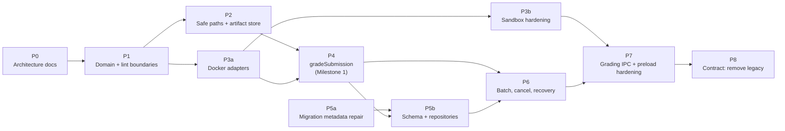

# 07 — Incremental Implementation Plan

> Terminology follows the [glossary](README.md#glossary). Each phase is designed as one to three small PRs that can be reviewed and reverted independently. Every PR must keep `npm run lint`, `npm run typecheck`, and `npm run test:ci` green on all three CI operating systems, and must keep statement coverage at or above 90 % (TEST-4, TEST-5).

## Phase overview

P5a has no code dependencies and can be done at any time. P3b can proceed in parallel with P4.

| Phase | Outcome                                                                              | Behaviour change visible to users                                       |
| ----- | ------------------------------------------------------------------------------------ | ----------------------------------------------------------------------- |
| P0    | This documentation                                                                   | none                                                                    |
| P1    | Pure domain module; ESLint import boundaries                                         | none                                                                    |
| P2    | `safePaths`, `fsArtifactStore`, `createSubmission`; W7 fixed                         | `submitCppSubmission` rejects or sanitises traversal IDs                |
| P3a   | `dockerCli` and the three Docker adapters; legacy compiler functions become wrappers | Image pulled before the timer; no common-directory mount; output capped |
| P3b   | Hardened sandbox flags; adversarial suite                                            | Containers non-root on Windows; tighter disk/file limits                |
| P4    | `gradeSubmission`, `createGradingEngine`, in-memory repository; **headless grading** | none (not wired to IPC)                                                 |
| P5a   | Correct Drizzle snapshot chain                                                       | none                                                                    |
| P5b   | New tables, Drizzle repositories, `openDatabase()`                                   | none (tables unused by the UI)                                          |
| P6    | `startBatch`, batch cancellation, progress, recovery, single-instance lock           | Second app instance is focused instead of started                       |
| P7    | `grading:*` IPC, selection IDs, gradebook read model, preload hardening              | New API for the renderer; gradebook shows correct counts                |
| P8    | Remove legacy channels, modules, tables, placeholder languages                       | Legacy API removed                                                      |

---

## P1 — Domain module and import boundaries

- **Objective:** capture today's grading rules as pure, tested functions and put the layer rules in place before any code moves.
- **Affected components:** new `src/main/grading/domain/*`; `eslint.config.mjs`; `src/main/compiler/dockerJudge.ts`.
- **Required changes:**
  1. `domain/types.ts`: `RunStatus`, `RunOutcome`, `Verdict`, `ResourceLimits`, `GradingPolicy`, `CapturedText`, `CompilationResult`, `ExecutionResult`, `TestCase`, `TestSuite`, `TestResult`, plus `DEFAULT_POLICY` with today's values (60 s compile, 5 s test, 256 MB, 1 CPU, pids 5, no compiler flags).
  2. `domain/judge.ts`: `compareOutput(expected, actual, 'normalized')`, synchronous and identical to `cleanOutput()`.
  3. `domain/verdict.ts`: `classifyExecution()` ([04 §5](04-grading-workflow.md#5-verdict-classification)).
  4. `domain/scoring.ts`: `scoreRun()`, computing `round(passed / total × 100)`.
  5. `domain/gradingRun.ts`: transition table; `transition(from, to)` throws on illegal moves.
  6. `domain/testSuite.ts`: canonical JSON and sha256 using `node:crypto`.
  7. `domain/errors.ts`: `GradingError` and codes ([03 §11](03-target-architecture.md#11-error-handling-and-failure-propagation)).
  8. `dockerJudge.ts`: replace the private `cleanOutput` with a call to `compareOutput`.
  9. ESLint: `no-restricted-imports` overrides for `src/main/grading/**` (ban `electron`, `@electron-toolkit/*`, `src/main/database/index`, `src/main/utils/file`) and for `src/main/grading/domain/**` (ban every import outside `domain/` except `node:crypto`).
- **Dependencies:** P0.
- **Testing requirements:** table-driven unit tests for every verdict path, every legal and illegal transition, and scoring edge cases (0 tests, all pass, rounding at .5). The existing `tests/compiler/dockerJudge.test.ts` must stay unchanged and green.
- **Acceptance criteria:** domain test coverage of 100 % statements; temporarily adding `import 'electron'` under `src/main/grading/` makes `npm run lint` fail (shown in the PR description); no runtime behaviour change.
- **Risks:** subtle drift from `cleanOutput()` semantics. Mitigated by making `dockerJudge` call the new function in the same PR, so the existing tests guard it.
- **Rollback / compatibility:** revert the PR. Nothing else depends on it yet.

## P2 — Safe paths, artifact store, submission intake

- **Objective:** give the engine an immutable, hashed submission snapshot and close the path-traversal hole (W7).
- **Affected components:** new `grading/infrastructure/storage/{safePaths,fsArtifactStore}.ts`, `grading/application/{ports,createSubmission}.ts`, `grading/infrastructure/persistence/inMemoryGradingRepository.ts` (submission methods only); `src/main/utils/file.ts`; `src/main/submissions/submitCppSubmission.ts`.
- **Required changes:**
  1. Move `sanitizeFileSegment` and `buildSafeRelativePath` from `utils/file.ts` and `getSubmissionRelativePath` from `utils/sourceFiles.ts` into `safePaths.ts`. Add `resolveInside(root, ...segments)`, which throws `UNSAFE_PATH` if the result escapes the root. `utils/file.ts` and `utils/sourceFiles.ts` import from `safePaths`.
  2. `fsArtifactStore` with `storeSubmission` (`lstat`, symlink rejection, extension allowlist, size and count limits, sha256, manifest v2, read-only files), `createWorkspace`, `storeTestSuite`, `writeRunArtifact`, `sweepWorkspaces`. The root directories are constructor parameters.
  3. `createSubmission` use case using `ArtifactStore` + `GradingRepository.insertSubmission`.
  4. `submitCppSubmission`: build the directory with `resolveInside` and sanitised segments. Keep the `SubmitCppResult` shape and manifest v1 so the existing IPC contract is unchanged. Full delegation to `createSubmission` happens in P7.
- **Dependencies:** P1.
- **Testing requirements:** real temp-directory tests for the store (cross-platform). The symlink test uses `it.skipIf` on Windows when symlink creation is not permitted. Traversal tests for `submitCppSubmission` (`studentId: '../../x'` stays inside `submissions/`). Existing `tests/utils/*` and `tests/submission/*` stay green.
- **Acceptance criteria:** an identical submission produces an identical `manifest_sha256`; no file is written outside the configured roots; W7 regression test passes.
- **Risks:** Windows path edge cases (drive letters, case-insensitivity, long paths). Mitigated by comparing paths with `path.relative` rather than string prefixes.
- **Rollback / compatibility:** `submitCppSubmission` keeps its shape. Revert restores the old path logic.

## P3a — Docker infrastructure adapters

- **Objective:** one module that owns Docker container lifecycle, with compile and run adapters behind ports; fixes W3, W4, W9 (for new code), W10 and W11.
- **Affected components:** new `grading/infrastructure/docker/{dockerCli,sandboxPolicy,dockerCppCompiler,dockerProgramRunner,dockerSandboxHost}.ts`; `dockerDetection.ts` moves into `infrastructure/docker/` with a re-export left at `src/main/compiler/dockerDetection.ts`; `src/main/compiler/{dockerCompile,dockerExecute,dockerJudge}.ts` become thin compatibility wrappers.
- **Required changes:**
  1. `dockerCli.runContainer({ createArgs, stdin, wallTimeMs, outputCaptureBytes, signal })` runs `create` → `start -a [-i]` → `inspect --format '{{json .State}}'` → `rm -f` (in `finally`), kills on timeout, abort or output cap, and labels every container. It returns the exit code, `timedOut`, `oomKilled`, `outputLimitExceeded`, the captured streams and `durationMs`.
  2. `sandboxPolicy` emits **today's** `DOCKER_SANDBOX_ARGS` values plus labels and mounts. New hardening flags wait for P3b to keep this PR reviewable.
  3. `dockerCppCompiler` mounts `workspace.sourceDir:/src:ro` and `workspace.buildDir:/build`, passes `./`-prefixed sources, and writes `/build/program` (no `.exe`, W18).
  4. `dockerProgramRunner` mounts the build directory read-only at `/app`, with stdin piped.
  5. `dockerSandboxHost` provides `checkAvailability` (wraps `detectDockerInstallation`), `prepareImage` (`image inspect`, then `pull`), and `removeOrphans`.
  6. Compatibility wrappers: `dockerCompile()` copies the given files into a workspace and compiles through the adapter, returning the same `DockerCompileResult` (the executable path now points inside the workspace build directory, which is retained until process exit, as today). `dockerExecute()` and `dockerJudge()` route through `dockerProgramRunner` and `compareOutput`.
- **Dependencies:** P1.
- **Testing requirements:** mocked-`spawn` unit tests for `dockerCli` covering the call sequence, kill on timeout, `rm -f` after errors, cap enforcement, abort, and malformed `inspect` output. Tests in `tests/compiler/*` that assert **result shapes** stay unchanged. Tests that assert exact `docker run` argument arrays are rewritten deliberately, and each rewrite is listed in the PR description.
- **Acceptance criteria:** IPC channels `compiler:dockerCompileCpp` and `compiler:dockerJudgeCpp` return the same shapes; a manual run on Linux and Docker Desktop shows (a) the first compile on a clean machine no longer times out during the pull, (b) a 1 GB allocation is reported as `oomKilled`. The `OOMKilled` behaviour with `--init` is recorded in the PR; if it is unreliable, apply the fallback in [04 §6.4](04-grading-workflow.md#64-memory-and-output-limits).
- **Risks:** Windows host-path handling (XP-3); parsing differences in `docker inspect` between Docker versions. Mitigate with JSON output and defensive parsing (`SANDBOX_STATE_UNKNOWN` on failure).
- **Rollback / compatibility:** the wrapper swap is the last commit of the PR, so it can be reverted alone and the adapters stay unused.

## P3b — Sandbox hardening

- **Objective:** apply the full control set from [06 §4](06-security.md#4-security-controls) and prove it with adversarial fixtures.
- **Affected components:** `sandboxPolicy.ts`; new `tests/integration/` and `tests/fixtures/adversarial/`; `vitest.config.ts` (integration include) only if needed.
- **Required changes:** `--read-only`, `tmpfs` for `/tmp` and `/work`, `--ulimit` (`core`, `nofile`, `fsize`), separate compile/run `pids` limits, a non-root `--user` on every platform ([06 §4.3](06-security.md#43-non-root-execution)). The Docker integration test harness is gated by `BATCHGRADE_DOCKER_TESTS=1` **and** a successful `checkAvailability()`.
- **Dependencies:** P3a.
- **Testing requirements:** every row of the [06 §9 checklist](06-security.md#9-verification-checklist-phase-p3b) as an integration test. Unit tests on the generated flag lists for each platform.
- **Acceptance criteria:** the checklist passes locally on Linux, Windows (Docker Desktop) and macOS, with results recorded in the PR. D7 (Windows non-root) is resolved or documented with the chosen fallback.
- **Risks:** legitimate student programs hitting the new limits (threads, file sizes). Every limit is a `GradingPolicy` value, overridable per assignment.
- **Rollback / compatibility:** flags are data in one module; individual flags can be reverted.

## P4 — `gradeSubmission` and the headless engine

- **Objective:** a complete single-submission grading workflow that runs without Electron.
- **Affected components:** `grading/application/{ports,gradeSubmission,runRegistry,cancelGrading}.ts`, `grading/createGradingEngine.ts`, `grading/infrastructure/persistence/inMemoryGradingRepository.ts` (complete), `tests/grading/**`, `tests/integration/gradeSubmission.test.ts`.
- **Required changes:** implement steps 3–12 of [04 §2](04-grading-workflow.md#2-lifecycle). Single-run cancellation through `runRegistry`. `createGradingEngine(deps)` as in [03 §12](03-target-architecture.md#12-dependency-injection-approach). Not wired to IPC.
- **Dependencies:** P2, P3a.
- **Testing requirements:** use-case tests with fake ports covering every state transition and error code: compile error, every verdict, infrastructure failure at each step (no score written), cancellation at each state, `CONTAINER_START_FAILED` retried exactly once, and workspace disposal on every path. The integration suite grades real fixtures. A non-asserting PERF-1 measurement test records timings.
- **Acceptance criteria:** see Milestone 1.
- **Risks:** use-case tests becoming coupled to call order. Assert on persisted state and outcomes, not on call sequences.
- **Rollback / compatibility:** nothing is wired to the app yet; revert freely.

### Milestone 1 — headless C++ grading

Milestone 1 is reached when all of the following hold:

1. On Linux, under `npm run test:ci` (plain Node, no Electron binary), the integration suite builds the engine with `dockerCppCompiler`, `dockerProgramRunner`, `dockerSandboxHost`, `fsArtifactStore` and `inMemoryGradingRepository`, and grades multi-file C++ fixtures into: `graded` with all tests passing; `graded` with `wrong_answer`, `runtime_error` and `time_limit_exceeded`; and `compile_error`.
2. Stopping Docker during a run produces `status: failed` with `DOCKER_UNAVAILABLE` and **no score**.
3. ESLint reports no `electron` imports under `src/main/grading/`, and the rule is active.
4. After the suite, no `batchgrade.managed` containers and no workspaces remain.
5. PERF-1 measurements for at least Linux and one Docker Desktop platform are added to [02 §3](02-requirements.md#3-performance-and-scalability), and D1 is updated.
6. All existing IPC channels behave as before; coverage stays at or above 90 %.

CI note: the Docker integration suite runs only where Docker is available (the `ubuntu-latest` runner). Enabling it in `.github/workflows/ci.yml` is a separate, explicit change in this phase. The Windows and macOS runners keep unit tests only.

## P5a — Migration metadata repair

- **Objective:** make `drizzle-kit generate` safe again (W24).
- **Affected components:** `src/main/database/migrations/meta/` only.
- **Required changes:** follow the procedure in [05 §9](05-data-model.md#9-migration-strategy), step 0. Document in the PR how the journal's `when` ordering is handled.
- **Dependencies:** none.
- **Testing requirements:** fresh-database migration (already exercised by `tests/setup.ts`). An upgrade test from a database created by the previous release's migrations. `drizzle-kit generate` reports no changes.
- **Acceptance criteria:** the snapshot chain `0000 → 0001 → 0002` is complete; no SQL migration files change.
- **Risks:** a wrong `prevId` chain. Mitigated by verifying with a second `generate` run.
- **Rollback / compatibility:** metadata only; revert freely.

## P5b — Persistence for grading

- **Objective:** durable submissions, runs, batches and results.
- **Affected components:** `src/main/database/schema/grading.ts` (new), `src/main/database/schema/{assignment,index}.ts`, migration `0003_*`, new `src/main/database/openDatabase.ts`, `src/main/database/index.ts`, `grading/infrastructure/persistence/{drizzleGradingRepository,drizzleAssignmentReader}.ts`.
- **Required changes:**
  1. Tables and columns from [05 §3](05-data-model.md#3-target-model), including `CHECK` constraints for I5 and the foreign-key actions for I11 and I12.
  2. `openDatabase(path, migrationsFolder)` without `electron`. `initDb()` becomes a thin Electron wrapper around it, keeping `getDb()` for the existing CRUD.
  3. Repositories receive the Drizzle instance.
- **Dependencies:** P4 (port contracts), P5a.
- **Testing requirements:** one **shared contract test suite** for `GradingRepository`, run against both `inMemoryGradingRepository` and `drizzleGradingRepository`. Migration upgrade test. Existing database tests stay green.
- **Acceptance criteria:** the contract suite passes for both implementations; migration `0003` is additive only; its journal `when` is greater than all existing entries.
- **Risks:** SQLite `ALTER TABLE` limitations (`ADD COLUMN` with a default is fine; constraints on existing tables are not), so new constraints go only on new tables.
- **Rollback / compatibility:** additive. Older app versions ignore the new tables. Downgrading after P5b leaves the extra tables unused.

## P6 — Batch grading, cancellation, progress, recovery

- **Objective:** a batch workflow with bounded concurrency, prompt cancellation and crash recovery.
- **Affected components:** `grading/application/{startBatch,runWithConcurrency,cancelGrading,recoverInterruptedWork,getGradingResults}.ts`; `src/main/index.ts` (single-instance lock, `recoverInterruptedWork()` at startup, abort-all on `before-quit`).
- **Required changes:** as in [04 §7](04-grading-workflow.md#7-batch-scheduling-and-bounded-concurrency) and [04 §9](04-grading-workflow.md#9-retry-and-recovery-semantics), including the circuit breakers and the deferred orphan sweep when Docker is down at startup.
- **Dependencies:** P4, P5b.
- **Testing requirements:** pool tests (limit respected, FIFO order, abort stops dispatch, errors isolated); batch tests with fakes (circuit breakers, cancellation in each phase, `done` resolves exactly once); recovery tests against the Drizzle repository; integration test with a 10-submission batch at concurrency 2.
- **Acceptance criteria:** cancelling a running batch leaves no containers within one `docker kill` round-trip plus `rm`; killing the app mid-batch, then restarting, yields `interrupted` and `failed/INTERRUPTED` with no orphans.
- **Risks:** races between cancellation and completion. `domain/gradingRun.transition` rejects writes to terminal states, so the first terminal write wins.
- **Rollback / compatibility:** not wired to IPC yet; revert freely.

## P7 — Grading IPC, file selections, gradebook read model, preload hardening

- **Objective:** expose the engine to the renderer safely, and stop the renderer from supplying host paths.
- **Affected components:** new `src/main/ipc/{gradingIpc,fileSelections,legacyIpc}.ts`; `src/main/index.ts`; `src/preload/{index,types}.ts`; `src/shared/` (new grading DTOs); `src/main/database/queries/gradebook.ts` (read model).
- **Required changes:**
  1. The channels in [03 §13](03-target-architecture.md#13-interface-layer-ipc-contract) with type-guard validation and result envelopes. `grading:progress` events are throttled.
  2. `file:select*` handlers register selections and return selection IDs for the new flows.
  3. `gradebook:getAll` returns the new-model grades merged with legacy rows ([05 §7](05-data-model.md#7-grades-and-feedback)).
  4. `submitCppSubmission` delegates to `createSubmission`.
  5. Move the existing handlers out of `index.ts` into `legacyIpc.ts` unchanged.
  6. Preload: add `window.api.grading`. Stop exposing `window.electron` (raw `ipcRenderer`) and set `sandbox: true`. The renderer is currently the electron-vite template, so this is the cheapest moment to do it.
- **Dependencies:** P3b (hardening before exposure), P6.
- **Testing requirements:** handler tests with a fake engine (validation rejects malformed payloads, envelopes, and that no handler accepts a raw path); gradebook read-model tests including legacy rows.
- **Acceptance criteria:** the renderer can grade a batch end to end through `window.api.grading` only; `gradebook:getAll` returns correct `passedCount` and `totalCount` for new runs.
- **Risks:** renderer work happens in parallel (EX-4), so the contract must be agreed with the UI developers before merging.
- **Rollback / compatibility:** the legacy channels remain, so reverting P7 restores the previous surface.

## P8 — Contract: remove legacy surface

- **Objective:** remove duplicated paths once nothing uses them.
- **Affected components:** `src/main/ipc/legacyIpc.ts` (removed channels: `compiler:dockerCompileCpp`, `compiler:dockerJudgeCpp`, `file:stringify`, `dialog:openFile`, `submissions:create`, `submissions:getById`, `submissions:submitCpp`, `gradebook:create`, `ping`); `src/main/compiler/*`; `src/main/submissions/*`; `src/main/database/queries/submissionServices.ts`; `languages.ts` Python/Java (EX-1); `src/shared/types.ts` schema re-exports; `src/shared/batchGrading.ts`; migration `0004` dropping `assignments`, `submissions`, `grades`, `compile_logs` (after the legacy export, D5).
- **Dependencies:** P7, plus confirmation that the renderer uses only the new API.
- **Testing requirements:** remove the corresponding tests; coverage stays at or above 90 %; upgrade test from a database containing legacy rows.
- **Acceptance criteria:** `grep` finds no references to the removed channels or modules; `src/shared` imports nothing from `src/main`.
- **Risks:** irreversible data removal. Ship the legacy export in an earlier release and require a database backup before migration `0004`.
- **Rollback / compatibility:** code removal can be reverted. The table drop can be undone only from a backup.

---

## Suggested PR sequence

| #   | PR title (Conventional Commits, no scope)                            | Phase |
| --- | -------------------------------------------------------------------- | ----- |
| 1   | `docs: design C++ grading backend architecture`                      | P0    |
| 2   | `refactor: extract pure grading domain module`                       | P1    |
| 3   | `build: enforce grading engine import boundaries`                    | P1    |
| 4   | `fix: prevent path traversal in submission storage`                  | P2    |
| 5   | `feat: add filesystem artifact store and submission snapshots`       | P2    |
| 6   | `refactor: add docker cli wrapper with explicit container lifecycle` | P3a   |
| 7   | `refactor: route legacy docker compile and judge through adapters`   | P3a   |
| 8   | `feat: harden grading sandbox containers`                            | P3b   |
| 9   | `test: add adversarial sandbox integration suite`                    | P3b   |
| 10  | `feat: add headless gradeSubmission use case`                        | P4    |
| 11  | `fix: restore missing drizzle migration snapshot`                    | P5a   |
| 12  | `feat: persist grading runs and results`                             | P5b   |
| 13  | `feat: add batch grading with bounded concurrency and cancellation`  | P6    |
| 14  | `feat: expose grading engine over ipc`                               | P7    |
| 15  | `refactor: remove legacy compiler ipc and tables`                    | P8    |
